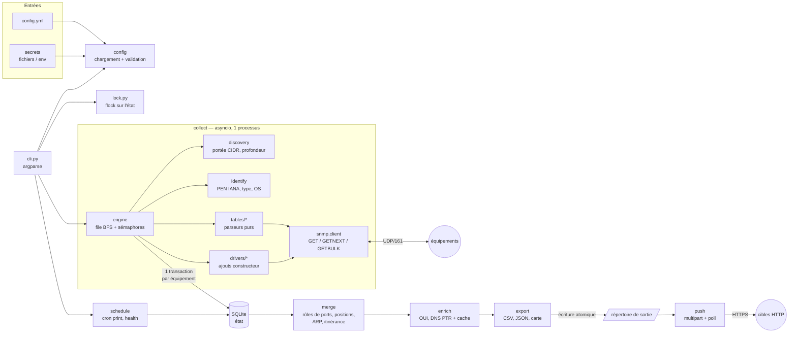
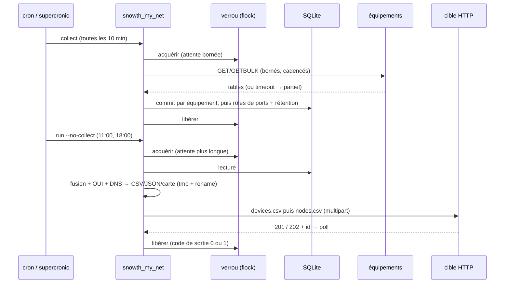

# snowth_my_net — Design

> Statut : **validé le 2026-09-15, avec amendements** (§0, qui prime sur le reste du document
> en cas de doute). Langue : ce document est en français ; le code, les identifiants, les
> messages de journal et `README.md` sont en anglais, `README.fr.md` en français, les références
> (`docs/`) en anglais.

## Sommaire

0. [Décisions validées](#0-décisions-validées)
1. [Principes](#1-principes)
2. [Architecture](#2-architecture)
3. [Découpage en modules](#3-découpage-en-modules)
4. [Dépendances et justification](#4-dépendances-et-justification)
5. [Schéma de configuration](#5-schéma-de-configuration)
6. [Schéma SQLite](#6-schéma-sqlite)
7. [Collecte SNMP](#7-collecte-snmp)
8. [Découverte et identité des équipements](#8-découverte-et-identité-des-équipements)
9. [Détection des uplinks](#9-détection-des-uplinks)
10. [Algorithme de fusion (pseudo-code)](#10-algorithme-de-fusion-pseudo-code)
11. [Formats de sortie](#11-formats-de-sortie)
12. [Push HTTP](#12-push-http)
13. [CLI](#13-cli)
13b. [Interface de gestion en terminal (TUI)](#13b-interface-de-gestion-en-terminal-tui)
14. [Planification](#14-planification)
15. [Déploiement](#15-déploiement)
16. [Sécurité](#16-sécurité)
17. [Plan de tests](#17-plan-de-tests)
18. [Phases d'implémentation](#18-phases-dimplémentation)
19. [Risques et particularités constructeur](#19-risques-et-particularités-constructeur)
20. [Questions](#20-questions)
21. [Extensibilité : OID, rapports et scripts personnalisés (proposition)](#21-extensibilité--oid-rapports-et-scripts-personnalisés-proposition)

---

## 0. Décisions validées

Réponses du 2026-09-15 aux questions de l'ancien §20. Elles sont intégrées dans les sections
concernées.

**Principe transversal : aucun réglage sur un parc particulier.** Chaque valeur par défaut est
justifiée de façon générique dans la doc, tout ce qui est propre à un site passe par la config,
et les drivers ne comblent que ce que les MIB standard ne peuvent pas dire. Ils sont choisis selon
les trous que révèlent des fixtures variées, jamais selon un client. Le chemin standard (MIB
IETF/IEEE) doit être juste sur tout agent conforme : c'est lui qu'on teste d'abord.

| # | Sujet | Décision |
|---|---|---|
| 1 | Fixtures | Jeu varié et synthétique : Cisco IOS/IOS-XE/NX-OS, HPE ProVision/AOS-CX/Comware, Juniper EX/SRX, Dell OS10, Arista, Fortinet, Sophos, Palo Alto, MikroTik, Ubiquiti UniFi/EdgeSwitch, Netgear/TP-Link, et des cas non réseau : hôte Linux net-snmp, imprimante, onduleur. LibreNMS (`tests/snmpsim`, **GPLv3**) sert de **référence** : aucun de ses fichiers n'est embarqué dans ce dépôt Apache-2.0. Les fixtures sont générées par nos scripts. Le corpus d'identification ne reprend que des chaînes factuelles émises par les équipements (`sysObjectID`, `sysDescr`, modèle), avec leur provenance. Les captures anonymisées de l'utilisateur viendront plus tard comme cas de régression |
| 2 | Langue | Code, logs et README.md en anglais ; README.fr.md en français ; références en anglais |
| 3 | CSV | CRLF par défaut (option `lf`), guillemets minimaux, en-têtes littéraux (`links.csv` sans guillemets). Golden files construits depuis ce document. `Last Seen` au format `YYYY-MM-DDTHH:MM:SSZ` |
| 4 | Uplinks | Strict par défaut, repli en option. **`uplink_mac_threshold: 50`** : un port d'accès porte légitimement beaucoup de MAC (AP en bridge local, hyperviseur, petit switch non géré) ; le seuil n'est qu'un filet pour les uplinks sans LLDP, et le transit simultané replace les MAC dès qu'un switch interrogé les voit ailleurs. Surchargeable par équipement. **`lag_is_uplink: false`** : un LAG entre switches gérés est déjà repéré par LLDP/CDP et par le transit ; un LAG vers un serveur est un port d'accès |
| 5 | `nodes.csv` | Toutes les positions dans la rétention, triées par Last Seen décroissant, avec l'IP courante de la MAC sur chaque ligne |
| 6 | Vendor des nœuds | Nettoyé ; vide pour une MAC administrée localement (marqueur dans le JSON) |
| 7 | Device Name | Tout ce qui suit le premier point est retiré (sauf si le sysName est une IP) ; doublon → suffixe ` (IP)`. `check` avertit des **sysNames d'usine** (identiques sur plusieurs équipements, égaux au modèle, ou génériques : « Switch », « Router »…). L'invariant de jointure `Switch` ⊂ `Device Name` est testé |
| 8 | Wi-Fi | Bridge local (v1, générique) : clients sur le port de l'AP, AP détecté par la capacité LLDP `wlanAccessPoint` du voisin, `ap_ports_are_access: true`. Tunnel vers un contrôleur (phase 5) : driver contrôleur qui publie des AP synthétiques dans `devices.csv` |
| 9 | Codes de sortie | `3` = verrou tenu au-delà de l'attente ; `devices[].tolerate_failure: true` (l'équipement reste dans les sorties, son échec ne donne pas le code 1) |
| 10 | Validation de la config | Validateur maison |
| 11 | Balayage actif | Présent en v1, vide par défaut, cadencé |
| 12 | Pare-feu HA | Par défaut, on interroge les membres ; une VIP qui répond avec le même numéro de série est un alias. `devices[].ha_mode: members\|vip` (§8.3) |
| 13 | Environnement | `uv` en local (Python 3.13), `git init`, pas de CI ; distribution : dépôt git + `docker compose build` (PyPI plus tard) ; licence **Apache-2.0** |
| 14 | Push | Bearer, Basic, `headers:` personnalisés dont la valeur vient d'un fichier ou de l'environnement ; proxy via `HTTPS_PROXY`/`NO_PROXY` ; reprises sur erreur réseau, 502, 503, 504 **et 429** (en respectant `Retry-After`) ; jamais sur 413 ni sur une autre 4xx |
| + | **Device Type** | Nouvelle colonne en fin de `devices.csv`, remplie **uniquement sur preuve sûre**, sinon vide (§7.5) |

Décisions du 2026-09-17 :

| Sujet | Décision |
|---|---|
| Licence | Apache-2.0 (déjà retenue) : fourni « tel quel », sans garantie ni responsabilité, et sans aucune obligation pour l'auteur. Usage personnel pour l'instant ; publication possible plus tard sans rien changer. Les dépendances sont sous licences permissives (MIT, BSD, ISC, Apache), listées dans `NOTICE`, qui cite aussi l'origine du corpus de test |
| Pas le piège Netdisco | **Le type ne conditionne jamais une collecte standard.** L'ARP, la FDB, LLDP et CDP sont tentés sur tout équipement ; seule une surcharge explicite `off` les coupe. Le type sert à trois choses : l'étiquette dans les sorties, les **propositions** d'OID du testeur, et le choix des drivers (ajouts constructeur, phase 5) |
| Typage manuel | Le type (et tout réglage par équipement) se fixe **à la main**, sans éditer le YAML : depuis le TUI ou `snowth_my_net device set`. Stocké dans l'état, prioritaire sur le YAML et sur la détection, avec la source affichée partout (§7.7) |
| Test d'OID à la main | Commande `probe` et onglet « Testeur d'OID » du TUI : GET/walk d'un OID libre ou d'un **préréglage**, avec les préréglages proposés selon le type (§7.7) |
| Interface | **TUI dans le terminal** (style nmtui, en plus beau), guidé et « fermé » : listes de choix, validation immédiate, confirmation des actions sensibles. Pas d'interface web. La CLI reste complète pour les scripts et cron (§13b) |

---

## 1. Principes

| Principe | Conséquence concrète |
|---|---|
| Lecture seule stricte | Un seul module importe la lib SNMP et n'expose que `get` / `walk` (GETNEXT, GETBULK). Un test AST échoue si `set_cmd`, `SetRequest`… apparaît où que ce soit. Aucun `subprocess` en v1. |
| Ne jamais se fier à l'annonce | `sysServices` et la classe devinée ne sont que des **étiquettes** d'affichage. Chaque MIB standard est tentée sur chaque équipement ; seule la **réponse effective** (table présente ou absente) décide. `auto / force / off` par fonction et par équipement. |
| Un équipement ne bloque jamais les autres | asyncio, délais à trois niveaux (requête, table, équipement), sémaphores globaux et par équipement. Chaque équipement est commité dans sa propre transaction SQLite dès qu'il se termine ; résultats partiels conservés et marqués. |
| L'état est la mémoire | Les observations (FDB, ARP, voisins) sont accumulées avec `first_seen` / `last_seen` entre deux exports. `Last Seen` = dernière observation réelle. |
| Sorties déterministes | Tri stable, horloge injectable, CSV à l'octet près (golden files). |
| Pas de supposition d'environnement | Le code ne sait pas s'il tourne dans un conteneur : chemins par config ou variables d'environnement, jamais codés en dur pour Docker. |
| Léger | 1 processus par exécution, SQLite, 4 dépendances directes, stdlib pour le reste (CLI, HTTP, CSV, cron, verrou). |

---

## 2. Architecture



Cycle planifié type (même logique en cron hôte ou dans le conteneur) :



---

## 3. Découpage en modules

```
src/snowth_my_net/
├── __main__.py              # python -m snowth_my_net
├── cli.py                   # argparse, sous-commandes, codes de sortie, --json
├── clock.py                 # horloge UTC injectable (tests déterministes)
├── logs.py                  # journaux stderr/--log-file, filtre de masquage des secrets
├── lock.py                  # flock non bloquant + attente bornée, info du détenteur
├── config/
│   ├── schema.py            # dataclasses typées (source unique du schéma)
│   ├── loader.py            # YAML safe_load, validation, clés inconnues, chemins, env
│   ├── secrets.py           # Secret (repr masqué), *_file / *_env, BOM/EOL, permissions
│   └── example.yml          # modèle commenté utilisé par `init` et testé
├── state/
│   ├── db.py                # connexion (WAL), migrations via PRAGMA user_version
│   ├── schema_v1.sql
│   └── repo.py              # upserts d'observations, requêtes, rétention
├── snmp/
│   ├── client.py            # SEUL import de pysnmp — get(), walk() ; aucun set
│   ├── credentials.py       # sélection par portée, sonde, cache de l'identifiant retenu
│   ├── oids.py              # OID numériques (aucune compilation de MIB)
│   └── values.py            # décodage : octets, MAC, InetAddress, index composés
├── collect/
│   ├── engine.py            # orchestration asyncio, budgets, résultats partiels
│   ├── discovery.py         # seeds, plages, exclusions, voisins → cibles, profondeur
│   ├── identify.py          # PEN → constructeur, type, OS/version, nom
│   └── tables/              # parseurs PURS (varbinds → enregistrements), testés unitairement
│       ├── system.py  entity.py  interfaces.py  ipaddr.py
│       ├── bridge.py        # dot1d + dot1q FDB, base ports, PVID, VLAN, fdbId → VLAN
│       ├── cisco_vlan.py    # vtpVlanState + FDB par contexte VLAN
│       ├── arp.py           # ipNetToPhysicalTable + ipNetToMediaTable
│       ├── lldp.py          # lldpRem/lldpLoc/lldpRemManAddr (+ LLDP-V2 en repli)
│       └── cdp.py
├── drivers/
│   ├── base.py              # interface Driver (voir §7.6)
│   └── generic.py           # phase 5 : cisco.py, fortinet.py, sophos.py, …
├── merge/
│   ├── macs.py              # normalisation, filtres (broadcast, multicast, LAA, ignorés)
│   ├── ports.py             # rôles access/uplink + raisons
│   ├── arp.py               # fusion (MAC, IP), IP courante
│   ├── nodes.py             # positions, itinérance, repli, trace pour `explain`
│   └── links.py             # dédoublonnage des liens LLDP/CDP
├── enrich/
│   ├── oui.py               # recherche MA-L/MA-M/MA-S, oui-update
│   ├── dns.py               # PTR asynchrone, cache SQLite, résolveurs configurables
│   └── data/                # oui.tsv.gz (généré), vendors_pen.tsv (table curée)
├── export/
│   ├── atomic.py            # tmp + fsync + os.replace
│   ├── csvout.py            # devices / nodes / links, en-têtes littéraux
│   ├── snapshot.py          # snapshot.json
│   ├── maps.py              # map.dot, map.mmd, map.html
│   └── map_template.html    # page autonome, JS/CSS inline, aucune ressource externe
├── push/http.py             # urllib + ssl, multipart, auth, poll, pas de redirections
└── schedule/
    ├── cron.py              # parseur cron 5 champs, génération crontab, intervalle max
    └── health.py
docker/entrypoint.sh
tests/  (unit/, integration/, golden/, fixtures/snmprec/, support/)
tools/  build_oui.py, walk2snmprec.py
```

Règle d'architecture : `collect/tables/*` et `merge/*` sont des fonctions **pures** (pas d'E/S) ;
toute la logique métier est testable sans réseau ni base.

---

## 4. Dépendances et justification

### 4.1 Bibliothèque SNMP : pysnmp 7 (asyncio, pur Python)

| Critère | **pysnmp 7.1.x** (LeXtudio) | Bindings net-snmp (`ezsnmp`, ex-`easysnmp`) |
|---|---|---|
| Installation `pipx` | Pur Python, aucun compilateur | Extension C : libnetsnmp à l'exécution, et compilateur + en-têtes si pas de wheel adaptée |
| Image Docker | Rien à ajouter au `-slim` | `libsnmp` + dépendances système (≈ +10-20 Mo), étape de build C |
| Concurrence | asyncio natif : des centaines de requêtes en vol sur un thread, délais via `asyncio.timeout` | Synchrone : pool de threads, état global de net-snmp (cache USM, MIB) peu sûr en multi-thread |
| SNMPv3 | USM complet ; auth MD5 → SHA-512 ; priv DES, 3DES, AES-128, AES-192/256 **dans les deux variantes** (Blumenthal et extension de clé Cisco) — vérifié dans la 7.1.29 | Complet (référence) |
| Contextes v3 (`vlan-<id>`) / `community@vlan` | `ContextData(contextName=…)` / simple chaîne | Oui |
| Performance | Décodage BER en Python : plus lent en CPU, mais la collecte est limitée par le réseau et le cadencement volontaire ; benchmark prévu en phase 1 | Plus rapide en CPU |
| Maintenance | Active (7.1.29 en 2026), API stable depuis 7.x | ezsnmp actif, easysnmp abandonné |
| Lecture seule | On n'importe que `get_cmd`, `next_cmd`, `bulk_cmd` dans un seul module | Idem |

**Choix : pysnmp `>=7.1,<8`.** Installation triviale dans les deux modes de déploiement, modèle
asyncio qui colle au besoin (beaucoup d'équipements lents en parallèle, un seul processus), et
aucune dépendance système. Les OID sont manipulés **en numérique** (`lookupMib=False`) : pas de
pysmi, pas de compilation de MIB. pysnmp est encapsulé derrière un protocole `SnmpClient`
(`get`, `walk`) : un changement de lib plus tard ne toucherait qu'un fichier.

**Mesure (phase 1)** : parcours GETBULK d'une FDB de 20 000 entrées servie par snmpsim, sur
cette machine. Le client consomme 87 µs de CPU par ligne avec `max_repetitions: 50` et 110 µs
avec 25, soit environ 2 s de CPU pour une très grosse table. Le débit observé, environ 4 000
lignes/s, est limité par snmpsim lui-même. En production, c'est le cadencement volontaire
(`pace_ms`, `per_device_concurrency`) qui domine, pas le décodage.

Point d'attention vérifié : pysnmp **ne déclare pas** `cryptography` en dépendance (seulement en
extra « dev »), alors qu'il en a besoin pour tout chiffrement SNMPv3. Nous la déclarons
explicitement, sinon authPriv échouerait à l'exécution.

### 4.2 Liste complète

| Dépendance | Rôle | Pourquoi pas la stdlib / une alternative |
|---|---|---|
| `pysnmp>=7.1,<8` (+ `pyasn1`) | SNMP v1/v2c/v3 asyncio | Voir ci-dessus |
| `cryptography` | Chiffrement SNMPv3 (DES/AES) utilisé par pysnmp | Requis par pysnmp ; wheels binaires, pas de compilation. Sert aussi aux tests (certificat auto-signé du faux serveur de push) |
| `PyYAML` | Lecture de la config (`safe_load` uniquement) | Pas de YAML en stdlib. `ruamel.yaml` inutile : `init` écrit un modèle statique commenté |
| `dnspython` | PTR avec résolveurs choisis, délai, asynchrone | `socket.gethostbyaddr` ne permet ni de choisir le résolveur, ni de fixer un délai, et bloque |
| `textual>=8,<9` (+ `rich`, `pygments`, `markdown-it-py`, `platformdirs`) | TUI de gestion (§13b), MIT | `curses` : rendu pauvre, pas de souris, beaucoup de code pour des formulaires ; `urwid` : aspect daté ; `prompt_toolkit` : orienté saisie, pas écrans. Textual donne tableaux, onglets, formulaires, thèmes, souris et un **pilote de test headless**. Environ 12 Mo installés. **Importé uniquement par la commande `tui`** : `collect` en cron ne le charge jamais |

Tout le reste en stdlib : `argparse` (CLI), `sqlite3`, `urllib.request` + `ssl` (push,
multipart écrit à la main, environ 40 lignes), `fcntl.flock` (verrou), `csv`, `json`,
`ipaddress`, `zoneinfo`, `gzip`, `asyncio`.

Écartés volontairement :
- **pydantic** pour la validation de la config : 5 paquets transitifs. À la place, des
  dataclasses et un validateur générique d'environ 150 lignes (types, `Literal`, listes,
  imbrication), qui signale les erreurs avec leur chemin (`devices[2].features.arp: expected
  auto|force|off`) et les clés inconnues (fautes de frappe) → code de sortie 2. *(Voir question Q10.)*
- **croniter** : maintenance historiquement instable, et on n'a besoin que de valider
  5 champs et de calculer l'écart maximal entre deux déclenchements (pour `health`).
  Environ 150 lignes testées.
- **requests/httpx** : urllib suffit pour un POST multipart et un GET de suivi.
- **click** : argparse suffit ; `rich` arrive avec Textual mais la CLI n'en dépend pas.

Dépendances de dev et de test : `pytest`, `snmpsim>=1.2` (même famille que pysnmp 7), `ruff`.

### 4.3 Données embarquées

- `oui.tsv.gz` : MA-L + MA-M + MA-S de l'IEEE, compacté (préfixe, longueur, nom), environ 500 Ko,
  généré par `tools/build_oui.py`. Vérifié : l'IEEE répond **HTTP 418** à l'User-Agent
  `Python-urllib`, d'où un User-Agent explicite dans `oui-update` et l'option `--from-file`.
- `vendors_pen.tsv` : table curée d'environ 40 numéros d'entreprise IANA → nom lisible et OS par
  défaut, surchargeable dans la config.

---

## 5. Schéma de configuration

Un seul fichier YAML, commun aux deux modes de déploiement. Le même fichier fonctionne sur l'hôte
et dans le conteneur grâce à trois règles :
1. Les **chemins de fichiers secrets relatifs** sont résolus depuis `general.secrets_dir`.
2. `state_dir`, `output_dir` et `secrets_dir` valent dans cet ordre : option CLI > variable
   d'environnement (`SNOWTH_STATE_DIR`, `SNOWTH_OUTPUT_DIR`, `SNOWTH_SECRETS_DIR`) > YAML >
   valeur par défaut. Compose positionne les variables.
3. La config est cherchée dans cet ordre : `--config` > `$SNOWTH_CONFIG` >
   `./snowth_my_net.yml` > `/etc/snowth_my_net/config.yml`.

Les secrets ne sont **jamais** en clair : les clés `community`, `auth_key`, `priv_key` et `token`
sont refusées (code 2, avec un message qui pointe vers `*_file` ou `*_env`).

```yaml
version: 1

general:
  state_dir: /var/lib/snowth_my_net        # state.sqlite, state.lock, oui mis à jour
  output_dir: /var/lib/snowth_my_net/output
  secrets_dir: /etc/snowth_my_net/secrets  # base des *_file relatifs
  log_file: null                           # en plus de stderr ; rotation 10 Mo x 5
  log_level: info
  device_name:
    strip_domain: first_dot                # first_dot | suffixes | none
    domain_suffixes: []                    # utilisé si strip_domain: suffixes
    duplicate_names: suffix_ip             # "sw (10.0.0.5)" si deux sysName identiques
  lock_wait: { collect: 60, default: 900 } # secondes d'attente du verrou
  run_timeout: 3000                        # budget global d'une exécution (s)
  retention_days: 90                       # équipements, liens et historique des runs non revus
  snmp:
    timeout: 3                             # par requête (s)
    retries: 1
    probe_timeout: 2                       # sonde d'identifiants (s), 0 reprise
    max_repetitions: 25                    # GETBULK
    use_bulk: true                         # false = GETNEXT (agents bogués)
    concurrency: 16                        # équipements en parallèle
    per_device_concurrency: 1              # requêtes simultanées vers un même équipement
    pace_ms: 0                             # pause mini entre deux requêtes vers un équipement
    table_timeout: 180                     # budget par table (s)
    device_timeout: 600                    # budget par équipement (s)
    max_rows_per_table: 500000             # garde-fou contre les boucles d'agent

credentials:                               # liste ORDONNÉE, filtrée par portée
  - name: v3-main
    version: 3
    scope: [10.0.0.0/16]                   # défaut : toutes les adresses
    username: snowth
    auth_protocol: sha256                  # md5|sha|sha224|sha256|sha384|sha512
    auth_key_file: snmp_v3_auth            # relatif à secrets_dir
    priv_protocol: aes128                  # des|3des|aes128|aes192|aes256|aes192c|aes256c
    priv_key_file: snmp_v3_priv            # (…c = extension de clé Cisco)
  - name: v2c-legacy
    version: 2c
    scope: [192.168.50.0/24]
    community_env: SNOWTH_V2C_COMMUNITY    # ou community_file:

discovery:
  seeds: [10.0.0.1, core-sw.corp.example.com, "10.0.5.10:1161"]
  allowed: [10.0.0.0/16, 192.168.50.0/24]  # AUCUNE requête hors de ces plages
  exclude: [10.0.99.0/24, 10.0.0.250]
  follow_neighbors: true                   # exploration LLDP/CDP
  max_depth: 3
  follow_capabilities: [bridge, router, wlan_ap]  # téléphones / stations jamais sondés
  sweep: []                                # CIDR à balayer activement (vide = désactivé)
  forget_after_days: 90

devices:                                   # surcharges ; la plus spécifique gagne (IP > CIDR)
  - address: 10.0.0.254
    type: firewall                         # switch|router|firewall|ap|other
    name: fw-main                          # remplace le sysName dans les sorties
    credential: v3-main                    # force l'identifiant
    features: { arp: force, fdb: off, lldp: auto, cdp: off, entity: auto }
    snmp: { max_repetitions: 10, pace_ms: 50 }   # douceur pour le CPU du pare-feu
  - address: 10.0.1.0/24                   # tous les switches Cisco d'accès
    vlan_indexing: auto                    # auto|cisco|off
    uplinks: [Te1/1/1, Te1/1/2]            # par ifName
    access_ports: [Po10]                   # force « accès » (bond LACP d'un serveur)
    uplink_mac_threshold: 200              # seuil propre à ces équipements
    driver: null                           # auto (phase 5) | nom | none
  - address: 10.0.0.250                    # VIP d'un cluster de pare-feu
    ha_mode: members                       # members (défaut) : membres interrogés, VIP = alias
                                           # vip : seule la VIP est interrogée, membres = alias
  - address: 10.0.9.3
    tolerate_failure: true                 # reste dans les sorties ; son échec ne donne pas le code 1

nodes:
  uplink_mac_threshold: 50                 # > N MAC apprises sur un port → uplink (filet de sécurité)
  lag_is_uplink: false                     # LAG vers serveur = accès ; LAG inter-switch vu par LLDP/transit
  ap_ports_are_access: true                # voisin AP non interrogé = port d'accès
  uplink_fallback: false                   # voir §9.3 (question Q4)
  include_unlocated: true                  # lignes sans Switch/Port (ARP seule…)
  include_device_macs: false
  positions: all                           # all | current (lignes par MAC dans nodes.csv)
  retention_days: 30
  prefer_ipv4: true
  current_ip_window: 24h                   # fenêtre pour élire l'IP courante
  ignore_macs: []
  ignore_mac_prefixes:                     # MAC virtuelles VRRP / HSRP par défaut
    - "00:00:5e:00:01"
    - "00:00:5e:00:02"
    - "00:00:0c:07:ac"
    - "00:00:0c:9f:f"

dns:
  enabled: true
  resolvers: []                            # vide = /etc/resolv.conf ; ex. [10.0.0.10]
  timeout: 2
  concurrency: 20
  cache_ttl: 24h
  negative_ttl: 1h
  strip_domain: false                      # garder le FQDN dans "DNS Name"

oui:
  file: null                               # chemin explicite, sinon état puis embarqué
  clean_names: true                        # "Cisco Systems, Inc" → "Cisco Systems"
  urls: [https://standards-oui.ieee.org/oui/oui.csv,
         https://standards-oui.ieee.org/oui28/mam.csv,
         https://standards-oui.ieee.org/oui36/oui36.csv]

export:
  files: [devices, nodes, links, snapshot, map]
  allow_empty: []                          # CSV autorisés à être vides (garde-fou, §11)
  csv: { line_terminator: crlf }           # crlf (RFC 4180) | lf
  links: { include_endpoints: false }      # téléphones/stations dans links.csv
  map:
    formats: [dot, mmd, html]
    endpoints: none                        # none | grouped (par port/VLAN) | all

push:
  targets:
    - name: cmdb
      url: https://cmdb.example.com/api/import?org=acme&format=nodes
      files: [devices, nodes]              # ordre respecté
      auth:
        bearer_token_file: /run/secrets/cmdb_token   # ou basic: {username, password_file}
      multipart_field: file
      extra_fields: {}                     # champs de formulaire additionnels
      tls_verify: true
      ca_bundle: null
      timeout: 120
      retries: 0                           # uniquement erreurs réseau / 502 / 503 / 504
      wait: false                          # = --wait pour les exécutions planifiées
      poll:
        url: https://cmdb.example.com/api/jobs/{id}?org=acme
        id_field: id                       # chemin pointé accepté : data.job.id
        status_field: status
        pending: [queued, running]
        success: [done]
        interval: 5
        timeout: 1800

schedule:
  collect: "*/10 * * * *"
  export_push: "0 11,18 * * *"
  timezone: null                           # ex. Europe/Brussels (sinon TZ du processus)
  health_max_age: auto                     # auto = 2 x plus grand écart entre deux collect
```

Format des durées : un entier (secondes) ou une chaîne `30s|10m|24h|7d`.

---

## 6. Schéma SQLite

`state_dir/state.sqlite` en mode WAL, `foreign_keys=ON`. La version du schéma est dans
`PRAGMA user_version`, avec des migrations numérotées appliquées sous verrou. Toutes les heures
sont en **epoch UTC (INTEGER)** et prises sur l'horloge du collecteur, jamais sur celle des
équipements.

```sql
CREATE TABLE runs (
  id           INTEGER PRIMARY KEY,
  command      TEXT NOT NULL,             -- collect|discover|export|push|run
  started_at   INTEGER NOT NULL,
  finished_at  INTEGER,
  status       TEXT,                      -- ok|partial|failed|aborted
  stats        TEXT                       -- JSON (volumes, durées, résultats de push)
);

CREATE TABLE devices (
  id            INTEGER PRIMARY KEY,
  mgmt_address  TEXT NOT NULL,            -- IP[:port] interrogée
  serial        TEXT,                     -- clés d'identité (§8.3)
  base_mac      TEXT,
  sys_name      TEXT, sys_descr TEXT, sys_object_id TEXT,
  sys_location  TEXT, sys_contact TEXT, sys_uptime INTEGER,
  vendor TEXT, pen INTEGER, device_type TEXT, type_source TEXT,   -- auto|config|driver
  model TEXT, os_name TEXT, os_version TEXT, driver TEXT,
  first_seen INTEGER NOT NULL, last_seen INTEGER NOT NULL,        -- dernier GET system OK
  last_collect_at INTEGER, last_collect_status TEXT
);
CREATE INDEX devices_serial   ON devices(serial);
CREATE INDEX devices_base_mac ON devices(base_mac);

CREATE TABLE targets (                    -- adresses à interroger (avant identification)
  address       TEXT PRIMARY KEY,
  origin        TEXT NOT NULL,            -- seed|neighbor|sweep
  depth         INTEGER NOT NULL DEFAULT 0,
  device_id     INTEGER REFERENCES devices(id) ON DELETE SET NULL,
  is_alias      INTEGER NOT NULL DEFAULT 0,   -- autre IP d'un équipement déjà connu
  credential    TEXT,                     -- NOM de l'identifiant retenu (jamais le secret)
  last_attempt_at INTEGER, last_ok_at INTEGER,
  consecutive_failures INTEGER NOT NULL DEFAULT 0,
  last_error    TEXT
);

CREATE TABLE device_chassis (device_id INTEGER REFERENCES devices(id) ON DELETE CASCADE,
  ent_index INTEGER, model TEXT, serial TEXT, sw_rev TEXT, descr TEXT,
  PRIMARY KEY (device_id, ent_index));
CREATE TABLE device_addresses (device_id INTEGER REFERENCES devices(id) ON DELETE CASCADE,
  address TEXT, ifindex INTEGER, prefix_len INTEGER, last_seen INTEGER,
  PRIMARY KEY (device_id, address));
CREATE TABLE device_macs (device_id INTEGER REFERENCES devices(id) ON DELETE CASCADE,
  mac TEXT, source TEXT, last_seen INTEGER,        -- bridge|ifphys|lldp_chassis
  PRIMARY KEY (device_id, mac));
CREATE INDEX device_macs_mac ON device_macs(mac);

CREATE TABLE interfaces (
  device_id INTEGER REFERENCES devices(id) ON DELETE CASCADE,
  ifindex INTEGER, name TEXT, descr TEXT, alias TEXT, if_type INTEGER,
  admin_status INTEGER, oper_status INTEGER, speed_mbps INTEGER, phys_mac TEXT,
  bridge_port INTEGER, pvid INTEGER, lag_ifindex INTEGER,   -- membre de cet agrégat
  role TEXT, role_reasons TEXT, mac_count INTEGER, role_at INTEGER,  -- §9
  last_seen INTEGER,
  PRIMARY KEY (device_id, ifindex));

CREATE TABLE vlans (device_id INTEGER REFERENCES devices(id) ON DELETE CASCADE,
  vlan_id INTEGER, name TEXT, last_seen INTEGER, PRIMARY KEY (device_id, vlan_id));

CREATE TABLE fdb_obs (                    -- observations FDB agrégées (historique des positions)
  mac TEXT NOT NULL, device_id INTEGER NOT NULL REFERENCES devices(id) ON DELETE CASCADE,
  ifindex INTEGER NOT NULL, vlan INTEGER NOT NULL DEFAULT 0,        -- 0 = inconnu
  vlan_source TEXT, method TEXT,          -- fdb|pvid|context ; qbridge|bridge|cisco_vlan|driver
  first_seen INTEGER NOT NULL, last_seen INTEGER NOT NULL, last_run_id INTEGER,
  PRIMARY KEY (mac, device_id, ifindex, vlan));
CREATE INDEX fdb_obs_port ON fdb_obs(device_id, ifindex, last_run_id);

CREATE TABLE arp_obs (                    -- une ligne par (MAC, IP, source) : historique complet
  mac TEXT NOT NULL, address TEXT NOT NULL, family INTEGER NOT NULL,   -- 4|6
  device_id INTEGER NOT NULL REFERENCES devices(id) ON DELETE CASCADE,
  ifindex INTEGER, source_table TEXT,     -- phys|media
  first_seen INTEGER NOT NULL, last_seen INTEGER NOT NULL, last_run_id INTEGER,
  PRIMARY KEY (mac, address, device_id));
CREATE INDEX arp_obs_addr ON arp_obs(address, last_seen);

CREATE TABLE neighbors (
  device_id INTEGER NOT NULL REFERENCES devices(id) ON DELETE CASCADE,
  ifindex INTEGER, protocol TEXT NOT NULL,             -- lldp|cdp
  remote_key TEXT NOT NULL,                            -- chassis id normalisé ou device id
  remote_chassis_id TEXT, remote_sys_name TEXT, remote_port_id TEXT, remote_port_desc TEXT,
  remote_mgmt_address TEXT, remote_caps TEXT, remote_platform TEXT,
  remote_device_id INTEGER, remote_ifindex INTEGER,    -- résolus si l'autre bout est connu
  local_port_method TEXT,                              -- trace du mapping lldpLocPortNum → ifIndex
  first_seen INTEGER, last_seen INTEGER, last_run_id INTEGER,
  PRIMARY KEY (device_id, protocol, remote_key, remote_port_id));

CREATE TABLE collect_status (             -- diagnostic par équipement / fonction (N derniers runs)
  run_id INTEGER, device_id INTEGER, function TEXT,    -- system|entity|if|ipaddr|fdb|arp|lldp|cdp…
  status TEXT,          -- ok|empty|absent|timeout|error|skipped|partial
  rows INTEGER, duration_ms INTEGER, detail TEXT,
  PRIMARY KEY (run_id, device_id, function));

CREATE TABLE dns_cache (address TEXT PRIMARY KEY, name TEXT,
  status TEXT, resolved_at INTEGER, expires_at INTEGER);   -- ok|nxdomain|timeout|servfail
```

Rétention, exécutée en fin de `collect` dans la même transaction que le calcul des rôles :
- `fdb_obs` et `arp_obs` avec `last_seen < now - nodes.retention_days` sont supprimées ;
- `neighbors`, les équipements et les cibles non revus depuis `general.retention_days` ou
  `discovery.forget_after_days` sont supprimés ;
- `collect_status` garde les 50 derniers runs, `runs` 90 jours.

---

## 7. Collecte SNMP

### 7.1 Client (`snmp/client.py`)

- Interface unique : `get(oids) -> dict`, `walk(base_oid) -> AsyncIterator[(oid, value)]`
  (GETBULK, ou GETNEXT si `use_bulk: false` ou en v1).
- Parcours colonne par colonne : on ne demande que les colonnes utiles, pas la table entière.
  Moins d'octets, moins de CPU côté équipement.
- Arrêt du parcours : sortie du sous-arbre, `endOfMibView`, `noSuchObject/Instance`, **OID non
  croissant** (bug d'agent classique : erreur explicite au lieu d'une boucle infinie), plafond
  `max_rows_per_table`.
- Délais : `timeout`/`retries` par requête ; `asyncio.timeout(table_timeout)` par table ;
  budget `device_timeout` par équipement ; `run_timeout` global. Un timeout garde les lignes
  déjà reçues (l'itérateur alimente une liste appartenant à l'appelant) et marque la fonction
  `partial`/`timeout`.
- Cadencement : sémaphore global (`concurrency`), sémaphore par équipement
  (`per_device_concurrency`, 1 par défaut), `pace_ms` entre deux PDU vers le même équipement,
  `max_repetitions` par équipement. Pas de rafale sur un pare-feu.
- VLAN Cisco : v2c → communauté `<communauté>@<vlan>` ; v3 → `contextName=vlan-<id>`.
- Un `SnmpEngine` pysnmp par identifiant (évite les collisions de cache USM entre utilisateurs
  homonymes aux clés différentes — à valider en phase 1).
- Journal de debug pysnmp jamais activé (il peut contenir la communauté).

### 7.2 Identifiants

Pour une cible : l'identifiant mémorisé (`targets.credential`) d'abord, puis la liste ordonnée
filtrée par `scope`. Sonde = un GET (`sysObjectID.0`, `sysName.0`) avec `probe_timeout` et
0 reprise. En v3, un mauvais utilisateur ou une mauvaise clé renvoie immédiatement un REPORT
(`usmStatsUnknownUserNames`, `usmStatsWrongDigests`) : on distingue « mauvais identifiant »
de « muet ». En v2c, une mauvaise communauté donne un silence, donc un timeout : c'est une bonne
raison de restreindre les `scope`. L'identifiant qui fonctionne est mémorisé.

### 7.3 MIB collectées (toutes tentées, sur tout équipement, sauf `off`)

| Fonction | Tables / colonnes (OID numériques dans `oids.py`) |
|---|---|
| `system` (toujours) | GET groupé : sysDescr, sysObjectID, sysUpTime, sysContact, sysName, sysLocation, sysServices (étiquette seulement), `dot1dBaseBridgeAddress.0`, `lldpLocChassisIdSubtype.0` / `lldpLocChassisId.0` (clés d'identité en un aller-retour ; repli en GET individuels en v1) |
| `entity` | entPhysicalClass, ContainedIn, Descr, Name, SoftwareRev, SerialNum, ModelName → châssis (classe 3 ; empilements : classe 11 « stack ») |
| `interfaces` | ifDescr, ifType, ifSpeed, ifPhysAddress, ifAdminStatus, ifOperStatus ; ifXTable : ifName, ifHighSpeed, ifAlias ; `ifStackTable` et `dot3adAggPortAttachedAggID` (appartenance aux LAG) |
| `ipaddr` | `ipAddrTable` (IPv4) **et** `ipAddressTable` (v4/v6) |
| `fdb` | `dot1qTpFdbPort/Status` (index fdbId.MAC), `dot1qVlanFdbId` (fdbId → VLAN), sinon `dot1dTpFdbPort/Status` ; `dot1dBasePortIfIndex` ; `dot1qPvid` ; `dot1qVlanStaticName` |
| `vlan_indexing` | `vtpVlanState` / `vtpVlanName` (CISCO-VTP-MIB), puis par VLAN opérationnel (hors 1002-1005) : `dot1dTpFdbPort/Status` + `dot1dBasePortIfIndex` en contexte VLAN ; `vmVlan` (VLAN d'accès) |
| `arp` | `ipNetToPhysicalTable` (Phys, Type, State) **et** `ipNetToMediaTable` (Phys, Type), les deux lues systématiquement |
| `lldp` | `lldpLocPortTable`, `lldpRemTable`, `lldpRemManAddrTable` ; repli LLDP-V2-MIB si vide |
| `cdp` | `cdpCacheTable` (Address, Version, DeviceId, DevicePort, Platform, Capabilities) |

Sémantique `auto | force | off` (par fonction, par équipement) :
- `off` : jamais interrogé ;
- `auto` : interrogé ; une table absente ou vide est enregistrée comme `absent`/`empty`, **ce n'est
  pas une erreur** ;
- `force` : interrogé ; une table absente ou vide **est** une erreur (statut `partial`, code 1,
  visible dans `check`). Ça sert à détecter qu'un pare-feu a cessé de servir son ARP.

`vlan_indexing: auto` fait le parcours par VLAN si et seulement si `vtpVlanState` **répond** et
que `dot1qTpFdbTable` est vide. C'est encore une décision prise sur une réponse effective,
jamais sur une annonce.

### 7.4 Détails de décodage

- **MAC** : 6 octets bruts, `001122334455`, `00:11:22:33:44:55`, `00-11-…`, `0011.2233.4455`,
  `0:11:2:…` (non paddé), `00 11 22 …` → `00:11:22:33:44:55`. Toute autre longueur est rejetée.
- **Index `ipNetToPhysicalTable`** : `ifIndex.type.len.addr` ; on tolère l'absence du préfixe de
  longueur (4 ou 16 octets restants), et `ipv4z`/`ipv6z` (on retire la zone).
- **Filtres ARP** : `Type ∈ {invalid, local}` écarté ; `State = incomplete` écarté ; MAC vide ou
  nulle écartée.
- **Filtres FDB** : statut `learned(3)` gardé ; `self/mgmt/invalid` écartés ; colonne de statut
  absente → considéré `learned` ; port 0 écarté.
- **fdbId → VLAN** : via `dot1qVlanFdbId` ; sans cette table, fdbId = VLAN si 1 ≤ fdbId ≤ 4094
  (trace `vlan_source=fdb_assumed`) ; si toutes les entrées partagent un fdbId (SVL), PVID du port.
- **Port de bridge → ifIndex** : `dot1dBasePortIfIndex` ; absent → identité (option
  `bridge_port_is_ifindex`).
- **Chaînes** : UTF-8 avec remplacement des caractères invalides, NUL retirés ; `sysDescr` mis sur
  une ligne pour les CSV (CR, LF et tabulations remplacés par des espaces, espaces compactés).
- **Nom court de port** : `ifName` ; s'il est vide, `ifDescr` abrégé
  (GigabitEthernet→Gi, TenGigabitEthernet→Te, FastEthernet→Fa, TwentyFiveGigE→Twe,
  FortyGigabitEthernet→Fo, HundredGigE→Hu, Port-channel→Po…) ; sinon l'ifIndex. La même table
  normalise les ports distants CDP (souvent en forme longue).

### 7.5 Identification

- **Constructeur** : PEN de `sysObjectID` (`1.3.6.1.4.1.<PEN>`) → table curée (9 Cisco,
  11 HPE, 14823 et 47196 HPE Aruba, 2636 Juniper, 12356 Fortinet, 2604 Sophos, 14988 MikroTik,
  41112 Ubiquiti, 30065 Arista, 25461 Palo Alto…). Les PEN « de pile SNMP générique »
  (8072 net-snmp, 4413 Broadcom) sont marqués ambigus → repli sur l'OUI de la MAC de base et sur
  des motifs de `sysDescr` (UniFi, EdgeSwitch, pfSense…).
- **OS / version**, par ordre : driver → motifs par constructeur sur `sysDescr`
  (`IOS-XE`/`17.9.4`, `IOS`/`15.2(7)E4`, `NX-OS`, `AOS-CX`/`FL.10.10.1010`, `Junos`/`21.4R3-S4.9`…)
  → `entPhysicalSoftwareRev` du châssis → motif générique `Version X`. Les motifs sont testés sur
  un corpus de vrais `sysDescr` (voir Q1).
- **Type (`Device Type`) — uniquement sur preuve sûre, sinon vide.** Valeurs possibles :
  `switch`, `router`, `firewall`, `wireless`, `server`, `printer`, `facility`, `other`, ou vide.
  Vide signifie « pas de preuve sûre » : le consommateur décidera ou demandera à un humain.
  **On ne devine jamais** : une colonne vide vaut mieux qu'un type faux. On applique les règles
  dans l'ordre et la première qui conclut gagne. `type_rule` et `type_reason` sont enregistrés,
  exposés dans `snapshot.json`, et affichés par `show devices` et `explain`.
  0. `config` : `devices[].type`, déclaré par un humain.
  1. `lldp_caps` : capacités LLDP **de l'équipement lui-même** (`lldpLocSysCapEnabled`,
     standard, indépendant du constructeur). `wlanAccessPoint` sans `router` → `wireless`.
     Une combinaison ambiguë (`bridge`+`router`, `wlanAccessPoint`+`router` pour un routeur
     Wi-Fi) ne conclut pas seule.
  1b. `function_mib` *(ajout proposé, même esprit que la règle 1)* : présence d'une MIB de
     fonction standard. Printer-MIB (RFC 3805, `prtGeneralTable`) → `printer` ; UPS-MIB
     (RFC 1628, `upsIdent`) → `facility`. Deux GETNEXT, quel que soit le constructeur.
  2. `catalog` : sous-arbre `sysObjectID` (numéro d'entreprise IANA + sous-arbre produit), ou
     gamme de modèles ENTITY-MIB, **toujours restreint à son constructeur** (« S4148 » ne veut
     dire `switch` que chez Dell).
  3. `os` : un OS qui ne tourne que sur un type de boîtier (FortiOS, SFOS, PAN-OS, NX-OS,
     AOS-CX, OS10, ArubaOS-Switch, EdgeSwitch…).
  4. `vendor` : un constructeur dont tous les produits gérés en SNMP sont d'un seul type (APC,
     Eaton, Rittal → `facility` ; Palo Alto → `firewall`), avec des vetos explicites (ex.
     Panorama, qui n'est pas un pare-feu).

  **Ne sont jamais une preuve** : `sysServices` seul ; un constructeur qui vend plusieurs types
  (HP, Dell, Cisco, Ubiquiti, Fortinet, Sophos…) ; un numéro de pièce isolé ; « Linux » ou
  « net-snmp » (AP, pare-feu et NAS tournent sous Linux) ; des mots-clés vagues de `sysDescr`.
  Le catalogue (`collect/catalog.py`) est vérifié contre un corpus de vrais `sysObjectID` /
  `sysDescr`, avec autant de cas « doit rester vide » que de cas positifs (§17). Le type n'est
  **qu'une étiquette** : il ne change rien à la collecte.

### 7.7 Typage manuel, réglages locaux et testeur d'OID

**Réglages manuels.** Tout ce que `devices:` permet par IP peut aussi être réglé depuis le TUI
ou `device set`, sans toucher au YAML (monté en lecture seule dans le conteneur) : `name`,
`type`, `credential`, `features.<fonction>`, `vlan_indexing`, `uplinks`, `access_ports`,
`uplink_mac_threshold`, `tolerate_failure`, `disabled`, `ha_mode`, `snmp.timeout|retries|
max_repetitions|use_bulk|pace_ms`. Chaque valeur est validée par le même schéma que le YAML.
Aucun secret n'est accepté (seulement le **nom** d'un identifiant).

- Stockage : table `manual_settings(address, key, value JSON, updated_at)` dans l'état
  (schéma v2).
- Priorité : **manuel > `config.yml` > détection/défaut**, champ par champ. `device show`,
  `check` et le TUI affichent la source (`manuel`, `config.yml`, `auto`) ; `check` signale un
  réglage manuel qui masque une valeur du YAML.
- Un type manuel s'applique **immédiatement** aux sorties (`export`, `show`) sans attendre la
  collecte suivante ; `type_rule` vaut `manual`.
- `device export-settings` / `import-settings` (YAML) permettent de sauvegarder ou de verser
  ces réglages dans `config.yml`.

**Préréglages d'OID** (`collect/presets.py`) : groupes nommés de colonnes standard, chacun avec
les types pour lesquels il est *proposé* (jamais imposé) :

| Préréglage | Contenu | Proposé pour |
|---|---|---|
| `system` | sysDescr, sysObjectID, sysName, sysLocation, sysUpTime, sysServices | tous |
| `entity` | classe, modèle, série, version logicielle (ENTITY-MIB) | tous |
| `interfaces` | ifName, ifDescr, ifType, ifOperStatus, ifPhysAddress, ifAlias | tous |
| `ip-addresses` | ipAddrTable, ipAddressTable | tous |
| `arp-media` / `arp-physical` | ipNetToMediaTable / ipNetToPhysicalTable | router, firewall, switch |
| `fdb-qbridge` / `fdb-bridge` | dot1qTpFdbTable / dot1dTpFdbTable + dot1dBasePortIfIndex | switch, wireless |
| `vlans` | dot1qVlanStaticName, dot1qPvid | switch |
| `cisco-vlans` | vtpVlanState, vtpVlanName | switch |
| `lldp-local` / `lldp-neighbors` | capacités et ports locaux / voisins | switch, router, firewall, wireless |
| `cdp-neighbors` | cdpCacheTable | switch, router |
| `printer` | Printer-MIB | printer |
| `ups` | UPS-MIB | facility |
| `host` | HOST-RESOURCES-MIB (hrDeviceDescr, hrStorage) | server |
| `enterprise` | les 50 premières valeurs du sous-arbre privé du constructeur (`1.3.6.1.4.1.<PEN>`) | tous |

Sans type connu, **tous** les préréglages sont proposés. Le testeur accepte aussi n'importe
quel OID numérique, en GET ou en walk borné (`--limit`, 50 lignes par défaut). Les valeurs sont
décodées (texte, MAC, IP, OID, entier, hexadécimal) et les colonnes d'une même table sont
alignées par index. Les requêtes passent par le même client en lecture seule, avec les délais
et le cadencement de l'équipement.

Exemple (le cas Sophos) :

```
$ snowth_my_net probe 192.0.2.254 arp-media
192.0.2.254 fw-edge — firewall (catalog) — credential v2c-lab — 3 rows in 0.2s
INDEX              ipNetToMediaPhysAddress  ipNetToMediaType
1.192.0.2.50       00:00:5e:00:53:a0        dynamic(3)
1.192.0.2.51       00:00:5e:00:53:a1        dynamic(3)
2.198.51.100.20    00:00:5e:00:53:b0        dynamic(3)
```

### 7.6 Drivers (préparés dès la phase 1, remplis en phase 5)

```python
class Driver(Protocol):
    name: str
    def score(self, ident: Identity) -> int: ...            # 0 = ne s'applique pas
    def refine_identity(self, ident, chassis) -> IdentityPatch: ...   # OS, version, modèle
    async def extra(self, ctx: DeviceContext) -> Contributions: ...  # FDB/ARP/clients Wi-Fi en plus
    quirks: Quirks          # bridge_port_is_ifindex, lldp_port_mapping, port_name_style…
```

Règle absolue : un driver **ajoute ou affine**, il ne retire jamais une collecte standard (seule
la config peut dire `off`). Pour le SSH futur, une classe `ShowCommandRunner` recevra une liste
blanche d'expressions régulières par driver (`^show [a-z0-9 /-]+$`), sans séparateurs de shell,
sans mode configuration, sans `shell=True`. L'interface est décrite, rien n'est livré en v1.

---

## 8. Découverte et identité des équipements

### 8.1 Cibles

Cibles d'un run :
- les `seeds` (les noms sont résolus à chaque run) ;
- les équipements connus de l'état (leur `mgmt_address`) ;
- les adresses du `sweep` s'il est configuré ;
- les voisins découverts pendant le run (BFS).

Chaque adresse est filtrée : dans `allowed`, hors `exclude`, sans quoi elle est **refusée et
tracée** (`discover` liste les voisins ignorés avec la raison : hors plage, exclu, profondeur,
capacité).

### 8.2 Exploration par voisins

Pendant `collect` (et `discover`) : l'adresse de management d'un voisin LLDP
(`lldpRemManAddrTable`, IPv4 de préférence) ou CDP (`cdpCacheAddress`) entre dans la file si les
conditions suivantes sont toutes remplies :
- `follow_neighbors` ;
- profondeur < `max_depth` ;
- capacités ∩ `follow_capabilities` non vide (un téléphone n'est jamais sondé) ;
- l'adresse n'appartient pas déjà à un équipement connu (`device_addresses`).

### 8.3 Identité et dédoublonnage

L'appel `system` récupère d'emblée `dot1dBaseBridgeAddress` et `lldpLocChassisId`. Clés, de la
plus forte à la plus faible :
1. `serial` du châssis principal (valeurs poubelle écartées : vide, `0`, `N/A`,
   `123456789`…) ;
2. `base_mac` (MAC de bridge, sinon chassis-id LLDP de sous-type MAC) ;
3. (`sysName`, `sysObjectID`) **et** |Δ`sysUpTime`| < 60 s entre deux IP interrogées dans le
   même run.

Une cible dont l'identité correspond à un équipement déjà revendiqué pendant le run est
enregistrée comme **alias** (son adresse va dans `device_addresses`, `is_alias=1`) et n'est plus
collectée. IP de management retenue : celle déclarée en seed ou en surcharge, sinon celle déjà
utilisée (stable), sinon la plus basse. Un changement de numéro de série à IP et sysName
constants (bascule d'un cluster HA, remplacement RMA) met à jour l'équipement et journalise un
avertissement au lieu de créer un doublon.

---

## 9. Détection des uplinks

> **Implémentation (phase 2), écarts assumés par rapport au texte ci-dessous :**
> - Les rôles de ports et les filtres de MAC (MAC d'équipements, `ignore_*`) sont calculés **à la
>   lecture** (export, `show`, `explain`, TUI) et non figés en fin de collecte. Un changement de
>   config ou de réglage manuel s'applique donc immédiatement, y compris sur l'historique, et
>   `explain` montre exactement la règle en vigueur.
> - Le nombre de MAC d'un port est celui du **dernier parcours FDB réussi** de l'équipement :
>   un parcours en échec ne fait jamais « rétrograder » un trunk, le rôle reste celui du dernier
>   parcours valide.
> - Le transit simultané utilise une fenêtre `nodes.transit_window` (30 min par défaut) plutôt
>   que « le même run » : si le switch d'accès rate une collecte, sa position reste la bonne au
>   lieu de basculer vers le port de transit.
> - La collecte ne stocke que des observations brutes (MAC unicast apprises, entrées ARP
>   valides) ; `fdb_obs` et `arp_obs` sont l'historique.
> - DNS : les PTR sont résolus à l'export (cache dans l'état, TTL positif et négatif, budget total
>   `dns.budget`) ; `show`, `explain` et le TUI n'utilisent que le cache.

### 9.1 Rôle d'un port (calculé en fin de `collect`, persisté dans `interfaces.role`)

Un port est **uplink** si au moins une de ces raisons s'applique (toutes enregistrées dans
`role_reasons` pour `explain`) :

| Raison | Règle | Force |
|---|---|---|
| `config` | Port listé dans `devices[].uplinks` | dure |
| `neighbor_managed` | Voisin LLDP/CDP résolu vers un équipement **interrogé qui a déjà fourni une FDB** (dans la rétention) | dure |
| `neighbor_infra` | Voisin non interrogé qui annonce `bridge` ou `router` (capacités *activées*), **sans** `telephone`/`station` | souple |
| `lag` | ifType `ieee8023adLag(161)` ou membre d'un agrégat (`ifStackTable` / LAG-MIB), si `lag_is_uplink` | dure |
| `mac_count` | > `uplink_mac_threshold` MAC apprises sur le port pendant ce run | souple |

Exceptions, qui sont le cœur de la justesse du résultat :
- Un voisin qui annonce `telephone` (téléphone IP, souvent aussi `bridge` parce qu'il contient un
  mini-switch avec un PC derrière) **ne rend pas** le port uplink.
- Un voisin AP non interrogé (`wlan_ap`) → port d'accès si `ap_ports_are_access` : ses clients
  Wi-Fi sont localisés sur ce port. Si l'AP est interrogé et fournit une FDB, c'est
  `neighbor_managed` et les clients sont placés sur l'AP.
- `devices[].access_ports` force « accès » (bond LACP d'un hyperviseur, ESXi qui annonce CDP
  « switch »).
- **Pas de rétrogradation sur données manquantes** : si la collecte LLDP/CDP ou FDB d'un
  équipement a échoué pendant ce run, les rôles de ses ports calculés avec cette source sont
  **conservés** au lieu d'être recalculés sans elle. Une coupure LLDP passagère ne déverse donc
  pas un étage entier sur un trunk.

> **Implémentation (phase 3)** :
> - Les voisins LLDP/CDP sont stockés bruts ; la résolution de l'extrémité distante (adresse de
>   management, puis MAC de châssis, puis sysName) et les règles `neighbor_managed` /
>   `neighbor_infra` sont appliquées à la lecture, comme les autres rôles. Les voisins
>   « actuels » d'un équipement sont ceux de son dernier parcours LLDP (ou CDP) réussi.
> - CDP n'a pas de bit « point d'accès » : un voisin CDP dont la plateforme est une borne Cisco
>   (`AIR-…`, `C91xx`, `CW91xx`) reçoit la capacité `wlan_ap`.
> - Nouvelle clé `general.snmp.port` (161 par défaut) : port des seeds sans port explicite, des
>   voisins explorés et du balayage.
> - LLDP-V2-MIB (IEEE 802.1AB-2009) n'est pas encore lu : à ajouter si un agent réel ne sert que
>   cette version (rare) — voir « Pour aller plus loin ».

### 9.2 Correspondance port LLDP local → ifIndex

`lldpLocPortNum` n'est pas l'ifIndex chez tout le monde. On essaie dans l'ordre, et la méthode
retenue est enregistrée :
1. `lldpLocPortId` de sous-type `macAddress` → `ifPhysAddress`, si l'adresse est unique ;
2. `lldpLocPortId` de sous-type `interfaceName`/`local`/`interfaceAlias` → ifName, puis ifDescr,
   puis ifAlias (insensible à la casse, abréviations normalisées) ;
3. `lldpLocPortDesc` → ifDescr / ifName / ifAlias ;
4. `lldpLocPortNum` pris comme ifIndex s'il existe ;
5. `lldpLocPortNum` pris comme port de bridge → `dot1dBasePortIfIndex`.

Le port distant se résout de la même façon sur l'équipement distant s'il est connu.

### 9.3 Arbitrages de positionnement

- **Transit simultané** : une MAC vue *dans le même run* sur plusieurs ports d'accès (uplink sans
  LLDP sous le seuil) → on garde le port qui porte **le moins de MAC** ; les autres sont marqués
  `shadowed` dans `explain`.
- **MAC vue uniquement sur des uplinks** : par défaut (strict, conforme à la spec), aucune
  position, donc Switch/Port/VLAN vides. Avec `uplink_fallback: true` et **uniquement** si toutes
  ses observations sont sur des uplinks *souples* (switch non géré sans LLDP, voisin non
  interrogé), la MAC est placée sur le port souple qui porte le moins de MAC, avec
  `"position_kind": "behind_uplink"` dans le JSON. Voir Q4.

---

## 10. Algorithme de fusion (pseudo-code)

### 10.1 En fin de `collect` (sous verrou, dans une transaction)

```python
def finalize_collect(run, results, state, cfg, now):
    for dev in results:                       # déjà commité équipement par équipement
        own = own_macs(dev)                   # base_mac, ifPhysAddress, chassis-id LLDP
        state.upsert_device_macs(dev, own)

    ignored = state.all_device_macs() | cfg.nodes.ignore_macs   # si not include_device_macs
    for dev in results:
        if dev.fdb.status in (OK, PARTIAL):
            for e in dev.fdb.entries:          # (mac, ifindex, vlan, vlan_source, method)
                mac = normalize_mac(e.mac)
                if mac is None or is_multicast(mac) or mac in ignored or prefix_ignored(mac):
                    continue
                state.upsert_fdb_obs(mac, dev.id, e.ifindex, e.vlan or 0,
                                     first_seen=now, last_seen=now, run=run.id)
        if dev.arp.status in (OK, PARTIAL):
            for a in dev.arp.entries:          # union physTable ∪ mediaTable
                mac = normalize_mac(a.mac)
                if mac is None or is_multicast(mac) or a.type in (INVALID, LOCAL) \
                   or a.state == INCOMPLETE or mac in ignored:
                    continue
                state.upsert_arp_obs(mac, a.ip, dev.id, a.ifindex, a.table, now, run.id)

    for dev in results:
        for port in dev.interfaces:
            if sources_fresh(dev, port):        # LLDP/CDP/FDB OK pour ce run
                port.role, port.reasons, port.mac_count = classify_port(dev, port, run, state, cfg)
            # sinon : rôle précédent conservé (§9.1)
    state.apply_retention(now, cfg)
```

### 10.2 Résolution des nœuds (à l'export, et pour `show` / `explain`)

```python
def resolve_nodes(state, cfg, now) -> list[Node]:
    horizon = now - cfg.nodes.retention_days
    fdb  = state.fdb_obs(since=horizon)                 # groupé par MAC
    arp  = state.arp_obs(since=horizon)                 # groupé par MAC et par IP
    role = state.port_roles()                           # (device, ifindex) -> (role, reasons, macs)
    nodes = []
    for mac in sorted(set(fdb) | set(arp)):
        trace = Trace(mac)
        obs = fdb.get(mac, [])
        access = [o for o in obs if role[o.port].role == ACCESS]
        for o in obs:
            if o not in access: trace.discard(o, role[o.port].reasons)

        # Transit simultané : dans le run le plus récent, un seul port d'accès gagne
        newest_run = max((o.last_run_id for o in access), default=None)
        same = [o for o in access if o.last_run_id == newest_run]
        if len(same) > 1:
            keep = min(same, key=lambda o: (role[o.port].macs, -o.last_seen, o.port))
            for o in same:
                if o is not keep: access.remove(o); trace.shadowed(o, by=keep)

        positions = sorted(access, key=lambda o: o.last_seen, reverse=True)  # itinérance
        kind = "access"
        if not positions and cfg.nodes.uplink_fallback:
            soft = [o for o in obs if role[o.port].is_soft_only()]
            if soft and len(soft) == len(obs):
                positions, kind = [min(soft, key=lambda o: role[o.port].macs)], "behind_uplink"
        trace.rule(kind, positions)

        ips = merge_arp(arp.get(mac, []), arp_by_ip=state.arp_latest_by_ip())
        current_ip = elect_current_ip(ips, cfg.nodes)
        last_seen = max([o.last_seen for o in obs] + [i.last_seen for i in ips])
        nodes.append(Node(mac, positions, kind, ips, current_ip, last_seen,
                          first_seen=min(...), random=is_laa(mac), trace=trace))
    return nodes


def merge_arp(pairs, arp_by_ip):
    # pairs : observations (mac, ip, source) de cette MAC → une entrée par IP
    merged = group_by(pairs, key=ip) -> IpObs(ip, family, first_seen=min, last_seen=max,
                                              sources=[(device, table, last_seen)…])
    for i in merged:
        # IP réattribuée : une AUTRE MAC l'a revendiquée plus récemment → IP périmée pour celle-ci
        i.superseded = arp_by_ip[i.ip].mac != i.mac and arp_by_ip[i.ip].last_seen > i.last_seen
    return merged


def elect_current_ip(ips, cfg):
    cands = [i for i in ips if not i.superseded]
    if not cands: return None
    newest = max(i.last_seen for i in cands)
    cands = [i for i in cands if i.last_seen >= newest - cfg.current_ip_window]
    rank = lambda i: (0 if (cfg.prefer_ipv4 and i.family == 4) else 1,
                      1 if is_link_local(i.ip) else 0,
                      -i.last_seen, ip_sort_key(i.ip))
    return min(cands, key=rank)
```

### 10.3 Lignes de `nodes.csv`

```python
for n in nodes:
    rows_pos = n.positions if cfg.nodes.positions == "all" else n.positions[:1]
    for p in rows_pos:
        emit(mac=n.mac, vendor=oui(n.mac) if not n.random else "",
             ip=n.current_ip, dns=ptr(n.current_ip),
             switch=device_name(p.device),      # MÊME fonction que devices.csv
             port=port_name(p.device, p.ifindex), vlan=p.vlan or pvid(p) or "",
             last_seen=iso_z(p.last_seen))
    if not rows_pos and cfg.nodes.include_unlocated:
        emit(mac, vendor, ip, dns, "", "", "", iso_z(n.last_seen))
sort(rows, key=(last_seen DESC, mac, switch, port))
```

Invariant testé : tout `Switch` non vide de `nodes.csv` figure dans la colonne `Device Name` de
`devices.csv` du même export. Une position qui pointe vers un équipement sorti de la rétention est
retirée.

---

## 11. Formats de sortie

Règles communes :
- Écriture atomique : `.<nom>.tmp-<pid>` dans le même répertoire, `fsync`, `os.replace`, puis
  `fsync` du répertoire.
- CSV en UTF-8 sans BOM, RFC 4180 : fin de ligne CRLF par défaut (option `lf`), champs de données
  entre guillemets seulement si nécessaire (virgule, guillemet, CR/LF), guillemets doublés. Les
  **en-têtes sont écrits littéralement**, octet pour octet, depuis des constantes testées par
  golden files (voir Q3).
- Heures : `YYYY-MM-DDTHH:MM:SSZ`, UTC, à la seconde, identiques sur toutes les lignes.
- **Garde-fou** : un CSV sans ligne de données n'écrase pas le précédent et n'est pas poussé ; la
  commande se termine avec le code 1 et un message explicite, sauf si le fichier figure dans
  `export.allow_empty`.

### 11.1 `devices.csv`

```
"Device Name","Device Details","IP Address",Location,Model,Serial,Vendor,"Operating System","OS Version","MAC Address","Device Type"
```

Les dix premières colonnes et leur ordre sont figés. `"Device Type"` est ajoutée en dernier ; un
consommateur qui ne la connaît pas l'ignore. Option `export.devices.include_type: false` pour la
retirer.

| Colonne | Source | Exemple |
|---|---|---|
| Device Name | `devices[].name` > sysName (domaine retiré selon `strip_domain`) > IP ; doublons suffixés ` (IP)` | `core-01` |
| Device Details | sysDescr, sur une ligne | `Cisco IOS Software [Cupertino], …` |
| IP Address | IP interrogée, **sans le port** même s'il n'est pas standard (le port est dans le JSON) | `10.0.0.1` |
| Location | sysLocation | `Bruxelles - Local technique 2` |
| Model | entPhysicalModelName du châssis principal (repli : Name/Descr) | `C9300-48P` |
| Serial | entPhysicalSerialNum du châssis principal (tous les membres d'une pile dans le JSON) | `FOC2345X0AB` |
| Vendor | table PEN (repli OUI) | `Cisco` |
| Operating System | identification | `IOS-XE` |
| OS Version | identification | `17.9.4` |
| MAC Address | dot1dBaseBridgeAddress, sinon chassis-id LLDP de type MAC, sinon vide | `00:1a:2b:3c:4d:5e` |

Tri : Device Name (tri naturel), puis IP.

### 11.2 `nodes.csv`

```
"MAC Address",Vendor,"IP Address","DNS Name",Switch,Port,VLAN,"Last Seen"
```

| Colonne | Source |
|---|---|
| MAC Address | minuscules, deux-points |
| Vendor | OUI IEEE (nom nettoyé si `clean_names`) ; vide pour une MAC administrée localement |
| IP Address | IP courante (§10.2) |
| DNS Name | PTR de l'IP courante (cache) |
| Switch | `device_name()` de l'équipement de la position — **même fonction** que `Device Name` |
| Port | nom court (§7.4) |
| VLAN | FDB Q-BRIDGE, contexte VLAN Cisco, sinon PVID |
| Last Seen | dernière observation **de cette position** (ou de la MAC pour une ligne sans position) |

Une ligne par (MAC, position), triée par Last Seen décroissant, puis MAC, Switch et Port.

### 11.3 `links.csv`

```
Local Device,Local Port,Remote Device,Remote Port,Protocol,Last Seen
```

- Un lien physique = une ligne, même s'il est vu des deux côtés et par LLDP et CDP. Les deux bouts
  sont ordonnés (Device Name local ≤ distant). Protocol vaut `LLDP`, `CDP` ou `LLDP+CDP`.
- Remote Device : Device Name si l'équipement est connu ; sinon sysName LLDP ou deviceId CDP
  (domaine retiré, suffixe `(SERIAL)` de NX-OS retiré), sinon chassis-id.
- Les téléphones et les stations en sont exclus, sauf si `links.include_endpoints`.

### 11.4 `snapshot.json` (extrait)

```json
{
  "schema": "snowth_my_net/snapshot/1",
  "generated_at": "2026-09-15T11:00:04Z",
  "tool_version": "0.1.0",
  "last_collect": {"run_id": 812, "finished_at": "2026-09-15T10:52:31Z", "status": "partial"},
  "devices": [{
    "name": "core-01", "ip": "10.0.0.1", "aliases": ["10.0.255.1"],
    "vendor": "Cisco", "type": "switch", "type_source": "auto",
    "model": "C9300-48P", "serial": "FOC2345X0AB", "os": "IOS-XE", "os_version": "17.9.4",
    "base_mac": "00:1a:2b:3c:4d:5e", "location": "…", "chassis": [{"model": "…", "serial": "…"}],
    "interfaces": [{"ifindex": 8, "name": "Gi1/0/1", "alias": "PC compta", "type": 6,
                    "oper": "up", "speed_mbps": 1000, "pvid": 20, "role": "access",
                    "role_reasons": [], "mac_count": 1}],
    "vlans": [{"id": 20, "name": "USERS"}],
    "collection": {"status": "ok", "duration_s": 12.4, "credential": "v3-main",
                   "functions": {"fdb": {"status": "ok", "method": "qbridge", "rows": 1834},
                                 "arp": {"status": "ok", "rows": 412}}},
    "errors": []
  }],
  "nodes": [{
    "mac": "3c:52:82:aa:bb:cc", "vendor": "HP", "random_mac": false,
    "first_seen": "2026-08-02T07:10:00Z", "last_seen": "2026-09-15T10:50:02Z",
    "current_ip": "10.20.0.53", "dns_name": "pc-compta-03.corp.example.com",
    "position_kind": "access",
    "positions": [{"device": "sw-2f", "port": "Gi1/0/12", "vlan": 20, "current": true,
                   "first_seen": "…", "last_seen": "…"}],
    "ips": [{"ip": "10.20.0.53", "first_seen": "…", "last_seen": "…",
             "sources": [{"device": "fw-main", "table": "ipNetToMediaTable", "last_seen": "…"}]}]
  }],
  "links": [{"a": {"device": "core-01", "port": "Te1/0/1"},
             "b": {"device": "sw-2f", "port": "Te1/1/1"},
             "protocols": ["LLDP", "CDP"], "last_seen": "…"}],
  "errors": [{"device": "10.0.9.3", "function": "system", "error": "timeout",
              "tried_credentials": ["v3-main", "v2c-legacy"]}]
}
```

### 11.5 Carte

- `map.dot` : graphe non orienté ; formes par type (switch = boîte, routeur = ellipse,
  pare-feu = octogone, AP = triangle) ; arêtes étiquetées `Gi1/0/48 — Te1/1/1`.
- `map.mmd` : `graph LR` Mermaid, identifiants assainis.
- `map.html` : **un seul fichier autonome**. Données JSON et JS/CSS inline (placement par forces
  avec graine fixe, zoom et déplacement, recherche MAC/IP/nom, clic sur un équipement → ports et
  nœuds), aucune ressource externe, lisible hors ligne.
- Nœuds terminaux selon `map.endpoints` : `none`, `grouped` (une bulle par port ou VLAN,
  « Gi1/0/5 : 3 hôtes ») ou `all`.

---

## 12. Push HTTP

- `urllib.request` + contexte `ssl` : vérification activée par défaut, `ca_bundle` possible,
  `tls_verify: false` produit un avertissement **à chaque exécution**. Les proxys suivent les
  variables standard `HTTPS_PROXY` et `NO_PROXY`.
- **Aucune redirection suivie** (un 301/302 transformerait le POST en GET et pourrait renvoyer
  l'en-tête `Authorization` ailleurs) : un 3xx est un échec, avec l'URL cible dans le message.
- Corps `multipart/form-data` construit à la main : champ `multipart_field` (`file`),
  `filename="devices.csv"`, `Content-Type: text/csv` (`application/json` pour snapshot), plus
  les `extra_fields`.
- Un fichier à la fois, dans l'ordre de `files`. Avant l'envoi, on revérifie qu'il existe, qu'il
  a au moins une ligne de données, et qu'il vient de l'export du même run dans le cas de `run`.
  Un fichier dont l'export a été bloqué par le garde-fou est `FAILED`, jamais remplacé par
  l'ancien.
- 2xx = OK. Le corps de la réponse est journalisé, tronqué à 4 Ko, caractères de contrôle
  échappés. 202 avec `--wait` ou `wait: true` : on extrait `id_field` (chemin pointé) du JSON,
  puis GET `poll.url` toutes les `interval` secondes. Un statut dans `pending` continue, un statut
  dans `success` vaut OK ; tout autre statut, ou dépassement de `timeout`, vaut FAILED.
- Authentification : Bearer (`bearer_token_file` / `_env`), Basic (`username` +
  `password_file` / `_env`), et `headers:` personnalisés dont chaque valeur vient d'un fichier
  ou d'une variable d'environnement (`{X-Api-Key: {file: /run/secrets/api_key}}`), jamais en
  clair.
- `retries` uniquement quand la requête n'a pas été traitée : erreur réseau, 502/503/504, et
  **429** en respectant `Retry-After` (secondes ou date HTTP, plafonné au `timeout` de la cible).
  **Jamais** de reprise sur 413 ni sur une autre 4xx : un import n'est pas idempotent.
- Résumé final (texte ou `--json`) avec `cible / fichier / OK|FAILED / code HTTP / durée / job`.
  Code 1 si au moins un échec. `--dry-run` montre ce qui serait envoyé.
- Token : lu depuis un fichier (BOM UTF-8 et espaces ou fins de ligne en bout retirés) ou depuis
  l'environnement, jamais journalisé, masqué par le filtre de logs. Avertissement si le fichier est
  lisible par le groupe ou par tous (`mode & 0o077`).

---

## 13. CLI

```
snowth_my_net [--config PATH] [--json] [--log-level LEVEL] [--log-file PATH] [-q] <commande>
```

| Commande | Rôle | Verrou |
|---|---|---|
| `init [--output PATH] [--force]` | Écrit la config d'exemple commentée | — |
| `check [ADDR…] [--quick] [--save]` | Config, secrets (lisibles, permissions), état, répertoire de sortie, DNS ; puis, par équipement : joignable, identifiant retenu, RTT, identité, type et règle, et pour chaque MIB `ok(n)` / `absent` / `timeout` / `error`. `--quick` = un seul GETNEXT par MIB. Avertissements : **sysNames d'usine** (identiques sur plusieurs équipements, égaux au modèle, ou génériques comme « Switch » ou « Router » ; la correction se fait sur l'équipement), identifiants v2c, secrets trop ouverts | non (sauf `--save`) |
| `discover [--dry-run]` | Seeds + exploration, sans FDB/ARP ; liste les voisins retenus et ignorés, avec la raison | oui |
| `collect [--device ADDR…]` | Collecte complète + rôles + rétention | oui |
| `export [--only devices,nodes,…]` | Fusion + enrichissement + écriture atomique | oui |
| `push [--target X] [--file F] [--wait] [--dry-run]` | Envoi des fichiers existants | oui |
| `run [--no-collect] [--no-push] [--wait]` | collect → export → push | oui |
| `show devices\|nodes\|links\|runs\|errors [--filter EXPR]` | Consultation de l'état | non (lecture seule) |
| `explain <mac\|ip>` | Pourquoi une MAC est là (voir ci-dessous) | non |
| `oui-update [--from-file DIR]` | Met à jour la base OUI dans `state_dir` | oui |
| `cron print [--format crontab\|cron.d\|supercronic] [--user U]` | Lignes générées depuis `schedule:` | — |
| `health [--max-age DUR]` | Code 1 si la dernière collecte réussie est trop ancienne | non |
| `tui` (ou `snowth_my_net` sans commande, dans un terminal) | Interface de gestion (§13b) | seulement pendant une collecte lancée depuis le TUI |
| `device show ADDR` | Réglages effectifs d'un équipement, avec la source de chaque valeur (défaut, `config.yml`, manuel) | non |
| `device set ADDR clé=valeur…` | Réglage manuel : `type=firewall`, `features.arp=force`, `uplinks=Te1/1/1,Te1/1/2`, `tolerate_failure=true`… Validé comme le YAML | non (transaction SQLite courte) |
| `device unset ADDR clé…\|--all` | Retire un réglage manuel | non |
| `probe ADDR [PRÉRÉGLAGE\|OID…] [--get\|--walk] [--limit N]` | Test d'OID à la main (§7.7). Sans argument : liste les préréglages proposés pour le type, avec un essai rapide de chacun | non |

Codes de sortie :

| Code | Signification |
|---|---|
| 0 | OK |
| 1 | Échec partiel : équipement en échec, fonction `force` vide, push en échec, garde-fou CSV vide, `health` périmé |
| 2 | Erreur de configuration ou d'usage (YAML invalide, clé inconnue, secret illisible, cron invalide) |
| 3 | Verrou tenu par une autre exécution au-delà de l'attente (proposition, Q9) |
| 130 | Interruption (SIGINT/SIGTERM) : les résultats partiels déjà commités sont conservés |

Sortie lisible sur stdout, `--json` pour les scripts, journaux sur stderr. Exemple de `explain` :

```
$ snowth_my_net explain 3c:52:82:aa:bb:cc
MAC 3c:52:82:aa:bb:cc — HP (universally administered)
Current position : sw-2f Gi1/0/12 VLAN 20 — last seen 2026-09-15T10:50:02Z
Rule             : access port (1 MAC on port); 2 uplink sightings discarded

FDB sightings (retention 30d)
  ✔ sw-2f    Gi1/0/12  vlan 20  macs=1    last 2026-09-15T10:50:02Z  access
  ✘ sw-2f    Te1/1/1   vlan 20  macs=388  last 2026-09-15T10:50:02Z  uplink: neighbor_managed core-01 (LLDP), mac_count 388>20
  ✘ core-01  Te1/0/1   vlan 20  macs=412  last 2026-09-15T10:49:40Z  uplink: neighbor_managed sw-2f (LLDP+CDP), lag
  · sw-1f    Gi1/0/3   vlan 20  macs=1    last 2026-09-02T08:10:00Z  access (previous position — roaming)
ARP sightings
  10.20.0.53   fw-main  ipNetToMediaTable  last 2026-09-15T10:48:11Z  ← current IP (IPv4 preferred)
  10.20.0.17   core-01  ipNetToPhysical    last 2026-08-30T16:02:00Z  superseded (now 00:0c:29:11:22:33)
DNS  pc-compta-03.corp.example.com (cache, 2026-09-15T06:00:03Z)
```

---

## 13b. Interface de gestion en terminal (TUI)

`snowth_my_net tui`, ou `snowth_my_net` sans argument dans un terminal. Aussi dans le conteneur :
`docker compose run --rm snowth tui`.

**Principes** : guidé et fermé (listes de choix plutôt que saisie libre, validation au fil de
la frappe, confirmation avant de désactiver un équipement) ; tout au clavier avec les
raccourcis affichés en bas, souris acceptée ; langue du système (français ou anglais,
`general.language: auto|fr|en`) ; thèmes Textual (palette `ctrl+p`) ; jamais de secret affiché.

**Écrans (phase 1, enrichis à chaque phase)** :

```
┌ snowth_my_net ─────────────────────── dernière collecte 10:50Z ✔ 8/9 ─ 17 sept. 11:02 ┐
│ Équipements  │  Collectes                                                            │
├──────────────────────────────────────────────────────────────────────────────────────┤
│ / filtrer…                                                                           │
│ NOM            IP           TYPE            CONSTRUCTEUR  MODÈLE      ÉTAT   VU      │
│ fw-edge        192.0.2.254  firewall ✎      Sophos        —           ✔ ok   10:50Z  │
│ sw-access-01   192.0.2.11   switch          HPE Aruba     JL679A      ✔ ok   10:50Z  │
│ sw-generic-02  192.0.2.12   ?               —             —           ✔ ok   10:50Z  │
│ 192.0.2.19     192.0.2.19   ?               —             —           ✘ muet 09:40Z  │
├──────────────────────────────────────────────────────────────────────────────────────┤
│ ⏎ ouvrir  / filtrer  c collecter tout  r rafraîchir  ? aide  q quitter              │
└──────────────────────────────────────────────────────────────────────────────────────┘
```

- **Équipements** : tableau filtrable ; `✎` = type réglé à la main, `⚙` = type du YAML.
- **Fiche équipement** (onglets) :
  - *Identité* : sysDescr, OS, série, MAC, identifiant retenu, et **pourquoi ce type** (règle
    et raison) ;
  - *Réglages* : type (liste : automatique, switch, router, firewall…), fonctions
    ARP/FDB/LLDP/CDP… en `auto/force/off`, nom, tolérance aux pannes, désactivation ; chaque
    champ montre sa source et sa valeur par défaut ; `ctrl+s` enregistre, « Revenir à
    l'automatique » efface les réglages manuels ;
  - *Testeur d'OID* : préréglages proposés pour le type (★) puis les autres, champ OID libre,
    GET/walk, résultat en tableau ;
  - *Dernière collecte* : statut, durée et nombre de lignes par fonction, erreurs.
- **Actions** : `c` collecter cet équipement ou tout, avec journal en direct ; `k` diagnostic
  (`check`) de l'équipement.
- **Collectes** : historique des runs.
- Phases suivantes : *Nœuds* (recherche MAC/IP + `explain`), *Liens*, *Push* (test d'envoi),
  *Planning*.

**Concurrence** : le TUI ne tient pas le verrou de l'état ; il le prend seulement le temps
d'une collecte qu'il lance (sans attendre : si une collecte planifiée tourne, il le dit). Les
réglages manuels sont de courtes transactions SQLite. Les journaux vont dans un panneau du TUI
(et dans `log_file` si configuré), jamais sur le terminal sous l'interface.

**Tests** : pilote headless de Textual (`App.run_test`) : navigation, filtre, réglage du type,
testeur d'OID contre snmpsim, collecte lancée depuis le TUI.

## 14. Planification

- `schedule.collect` et `schedule.export_push` sont validés au chargement par un parseur cron
  5 champs : `*`, listes, plages, pas, noms de mois et de jours, raccourcis `@hourly`… sauf
  `@reboot`, avec la sémantique OU de Vixie quand jour du mois et jour de la semaine sont tous les
  deux restreints. Ce sous-ensemble est compris à la fois par cron et par supercronic.
- `cron print` écrit le chemin **absolu** de l'exécutable (pipx l'installe hors du PATH de cron),
  `--config` en absolu, `--quiet` et `CRON_TZ=` si `schedule.timezone` est défini :

  ```
  # snowth_my_net — generated from /etc/snowth_my_net/config.yml (schedule:)
  CRON_TZ=Europe/Brussels
  */10 * * * *   /usr/local/bin/snowth_my_net --config /etc/snowth_my_net/config.yml -q collect
  0 11,18 * * *  /usr/local/bin/snowth_my_net --config /etc/snowth_my_net/config.yml -q run --no-collect
  ```
  `--format cron.d --user snowth` ajoute la colonne utilisateur pour `/etc/cron.d/`.
- Collision à 11:00 (`collect` et `export_push` en même temps) : le verrou sérialise, et
  `export_push` attend jusqu'à `lock_wait.default` au lieu d'échouer. Un `collect` qui trouve le
  verrou tenu au-delà de `lock_wait.collect` sort avec le code 3 (journalisé) plutôt que
  d'empiler les exécutions.
- Verrou : `flock(LOCK_EX|LOCK_NB)` sur `state_dir/state.lock`, en boucle jusqu'à l'échéance ; le
  fichier contient PID, commande et heure de début pour le message « locked by pid 123
  (collect) since … ». Il est libéré automatiquement si le processus meurt, donc jamais de verrou
  orphelin. Il fonctionne entre l'hôte et les conteneurs qui partagent `./data` (même noyau). Il
  n'est **pas garanti sur NFS/CIFS** : l'état doit être sur un disque local (documenté).
- `health` : écart maximal entre deux déclenchements de `collect`, calculé sur 14 jours glissants,
  × 2 (ou `health_max_age`) ; lit l'état en lecture seule (`mode=ro`), sans jamais attendre le
  verrou. « Réussie » = run `ok` ou `partial` avec au moins un équipement collecté.
- Heures de sortie toujours en UTC ; `TZ` ou `schedule.timezone` ne sert qu'à interpréter le
  planning.

---

## 15. Déploiement

### 15.1 Hôte : pipx + cron ou timer systemd

```bash
sudo useradd --system --home /var/lib/snowth_my_net --shell /usr/sbin/nologin snowth
sudo pipx install --global snowth-my-net        # pipx ≥ 1.5 ; ou depuis un wheel / git
sudo -u snowth snowth_my_net init --output /etc/snowth_my_net/config.yml
sudo -u snowth snowth_my_net check
sudo -u snowth snowth_my_net cron print --format cron.d --user snowth | sudo tee /etc/cron.d/snowth_my_net
```

Timer systemd documenté (unités `oneshot`), avec un durcissement proche de celui du conteneur :

```ini
# snowth-collect.service
[Service]
Type=oneshot
User=snowth
ExecStart=/usr/local/bin/snowth_my_net -q collect
NoNewPrivileges=yes
ProtectSystem=strict
ReadWritePaths=/var/lib/snowth_my_net
PrivateTmp=yes
ProtectHome=yes
CapabilityBoundingSet=
RestrictAddressFamilies=AF_INET AF_INET6 AF_UNIX
TimeoutStartSec=55min

# snowth-collect.timer
[Timer]
OnCalendar=*:0/10
[Install]
WantedBy=timers.target
```

(`export_push` : `OnCalendar=*-*-* 11,18:00:00` → `run --no-collect`. La traduction
cron → OnCalendar est manuelle et documentée, pas générée.)

### 15.2 Docker Compose

**Image** (`Dockerfile`, multi-stage) :
- `build` (`python:3.13-slim`, Debian 13) : on construit le wheel du projet, puis un venv
  `/opt/venv` sans pip qui contient les dépendances. supercronic est récupéré avec
  `ADD --checksum=sha256:… …/supercronic-linux-${TARGETARCH}` : empreinte vérifiée par BuildKit,
  sans curl ni wget.
- `runtime` (`python:3.13-slim`) : copie de `/opt/venv` et de supercronic ; `pip` retiré ;
  `compileall` (le système de fichiers sera en lecture seule) ; utilisateur `10001:10001` ;
  `PYTHONDONTWRITEBYTECODE=1 PYTHONUNBUFFERED=1 HOME=/tmp`. Aucun outil de build. Taille estimée :
  environ 155 Mo décompressés, environ 55 Mo compressés (base 126 Mo mesurée).
- **Pourquoi pas distroless** : supercronic lance ses tâches via `/bin/sh -c`, absent de
  distroless (et l'image Python distroless fige sa version de Python). slim, c'est la cohérence
  sans compromis de sécurité notable une fois durci.
- `test` : `runtime` + pytest + snmpsim + `tests/`.

**Entrypoint** (`docker/entrypoint.sh`, POSIX sh) :
- sans argument ou avec `scheduler` : validation de la config (code 2 si invalide), puis
  `cron print --format supercronic > /tmp/crontab`, une collecte initiale en arrière-plan
  (`SNOWTH_COLLECT_ON_START=true`), et `exec supercronic -passthrough-logs /tmp/crontab` ;
- sinon : `exec snowth_my_net "$@"`, ce qui permet `docker compose run --rm snowth check`.

**`compose.yml`** :

```yaml
services:
  snowth:
    build: .
    image: snowth_my_net:${SNOWTH_VERSION:-latest}
    user: "${SNOWTH_UID:-10001}:${SNOWTH_GID:-10001}"   # = propriétaire de ./data, ./output, ./secrets
    command: ["scheduler"]
    environment:
      TZ: ${TZ:-UTC}
      SNOWTH_CONFIG: /etc/snowth_my_net/config.yml
      SNOWTH_STATE_DIR: /var/lib/snowth_my_net
      SNOWTH_OUTPUT_DIR: /output
      SNOWTH_SECRETS_DIR: /run/secrets
    volumes:
      - ./config/snowth_my_net.yml:/etc/snowth_my_net/config.yml:ro
      - ./data:/var/lib/snowth_my_net
      - ./output:/output
    secrets: [snmp_v3_auth, snmp_v3_priv, cmdb_token]
    read_only: true
    tmpfs: [/tmp]
    cap_drop: [ALL]
    security_opt: ["no-new-privileges:true"]
    init: true
    restart: unless-stopped
    logging:
      driver: json-file
      options: { max-size: "10m", max-file: "3" }
    healthcheck:
      test: ["CMD", "snowth_my_net", "health"]
      interval: 5m
      timeout: 30s
      retries: 2
      start_period: 30m
    # aucun "ports:" — rien n'est exposé

  # --- profil test ---
  sim-access:  { profiles: [test], build: {context: ., dockerfile: tests/docker/Dockerfile.snmpsim},
                 volumes: ["./tests/fixtures/snmprec/access:/data:ro"],
                 networks: {testnet: {ipv4_address: 172.31.250.11}} }
  sim-access2: { … 172.31.250.12 }     # voisin LLDP de sim-access
  sim-cisco:   { … 172.31.250.13 }     # indexation par VLAN (public@10, vlan-10…)
  sim-fw:      { … 172.31.250.14 }     # ARP via ipNetToMediaTable uniquement, sysServices sans L3
  # 172.31.250.99 : aucune machine → équipement muet
  fakepush:    { profiles: [test], …, networks: {testnet: {ipv4_address: 172.31.250.20}} }
  tests:
    profiles: [test]
    build: { context: ., target: test }
    depends_on: [sim-access, sim-access2, sim-cisco, sim-fw, fakepush]
    networks: [testnet]
    command: ["pytest", "-m", "unit or integration", "-q"]

secrets:
  snmp_v3_auth: { file: ./secrets/snmp_v3_auth }
  snmp_v3_priv: { file: ./secrets/snmp_v3_priv }
  cmdb_token:   { file: ./secrets/cmdb_token }

networks:
  testnet:
    ipam: { config: [{ subnet: 172.31.250.0/24 }] }
```

Points documentés dans le README :
- **Réseau** : le bridge par défaut suffit. SNMP UDP/161 et HTTPS sont sortants ; le trafic
  SNMP sort **avec l'IP de l'hôte** (NAT), c'est donc cette IP qu'il faut autoriser dans les ACL
  SNMP des équipements. `network_mode: host` n'est pas nécessaire. Aucune capacité requise :
  « joignable » est testé par SNMP, pas par ping.
- **Secrets** : en Compose hors Swarm, les secrets fichier sont montés tels quels (propriétaire et
  mode de l'hôte ; `uid`, `gid` et `mode` ne s'appliquent pas). D'où `user:
  ${SNOWTH_UID}:${SNOWTH_GID}` : le compte hôte propriétaire de `./secrets` (chmod 600), de
  `./data` et de `./output` est celui du processus. Pas d'avertissement de permissions, et les
  sorties sont lisibles depuis l'hôte.
- **DNS** : dans le conteneur, le résolveur par défaut est celui de Docker. Pour le DNS interne,
  on renseigne `dns.resolvers: [10.0.0.10]`, interrogé directement.
- **Exploitation** : `docker compose run --rm snowth check`,
  `docker compose run --rm snowth explain <mac>`, `docker compose run --rm snowth run --wait`,
  `docker compose logs -f snowth`.
- `.env.example` : `SNOWTH_VERSION`, `SNOWTH_UID`, `SNOWTH_GID`, `TZ`, `SNOWTH_COLLECT_ON_START`,
  `SNOWTH_V2C_COMMUNITY` (commenté, pour rappeler que `*_env` existe).

---

## 16. Sécurité

| Exigence | Mécanisme | Vérification |
|---|---|---|
| Aucun SET | Un seul module importe pysnmp, n'importe que `get_cmd`/`next_cmd`/`bulk_cmd` | Test AST : `set_cmd`, `setCmd`, `SetRequestPDU`, `snmpset` interdits partout ; pysnmp importé seulement dans `snmp/client.py`. Test d'intégration : un proxy UDP enregistre les PDU v2c et vérifie que seules les étiquettes 0xA0/0xA1/0xA5 (Get/GetNext/GetBulk) passent |
| Secrets jamais journalisés | Type `Secret` (`repr` → `***`) ; filtre de logs qui masque toute valeur de secret chargée (y compris dans `community@vlan`) ; l'état ne stocke que le **nom** de l'identifiant | Test : collecte en `DEBUG`, puis recherche de chaque secret dans stderr, le fichier de log, `snapshot.json` et la base SQLite → aucune occurrence |
| Pas de `shell=True` | Aucun `subprocess` en v1 | Test AST (`subprocess`, `os.system`, `os.popen` interdits) |
| Délais partout | SNMP (3 niveaux), DNS (`lifetime`), HTTP (`timeout`), poll, verrou, `run_timeout` | Tests avec équipement muet, proxy lent, serveur HTTP qui ne répond pas |
| Conteneur | non-root, `read_only`, `cap_drop: ALL`, `no-new-privileges`, aucun port | Test du profil Compose : `id -u` ≠ 0, écriture hors `/tmp` et volumes refusée |
| SNMPv3 | authPriv recommandé dans la doc et en tête de la config d'exemple ; avertissement dans `check` pour tout identifiant v2c | — |
| HTTP | TLS vérifié par défaut, pas de redirections, token en fichier `0600` | Tests de push |

---

## 17. Plan de tests

**Unitaires** (sans réseau, horloge figée) :
- normalisation des MAC (tous les formats du §7.4, longueurs invalides, multicast, broadcast,
  zéro, LAA) ;
- décodage des index composés (`ipNetToPhysical`, avec et sans longueur ; `lldpRemManAddr`) ;
- parseurs de chaque table à partir de listes de varbinds : FDB Q-BRIDGE avec correspondance
  fdbId → VLAN, BRIDGE-MIB, contextes VLAN, LAG, correspondance des ports LLDP (les
  5 méthodes) ;
- identification : corpus de vrais `sysObjectID` / `sysDescr` / modèles
  (`tests/data/identify_corpus.jsonl`, environ 270 équipements de ~40 constructeurs, dont des
  imprimantes, onduleurs, hôtes Linux et NAS), **au moins autant de cas « doit rester vide »
  que de cas typés**. Invariant vérifié sur chaque enregistrement : un type non vide est
  toujours le bon. Plus des cas synthétiques pour les capacités LLDP propres, les vetos
  (Panorama, PowerChute) et le cadrage par constructeur des familles de modèles ;
- fusion ARP : plus récent gagne, IP réattribuée, v4 prioritaire, fenêtre, lien-local ;
- rôles de ports : chaque raison, téléphone qui annonce `bridge`, AP, `access_ports`, pas de
  rétrogradation sur données manquantes ;
- positions : transit simultané, itinérance, repli, lignes sans position ;
- rétention ;
- CSV **golden files** (octet pour octet : en-têtes, CRLF, guillemets, UTF-8 sans BOM,
  caractères accentués dans `sysLocation`, virgules dans `sysDescr`) ;
- garde-fou CSV vide ; écriture atomique (échec au milieu → ancien fichier intact) ;
- parseur cron, `cron print`, écart maximal pour `health` ;
- validation de config : clés inconnues, secret en clair refusé, chemins, précédence env/CLI ;
- verrou (deux processus, attente, code 3).

**Intégration snmpsim** (lançables en local : snmpsim démarré par les fixtures pytest sur
`127.0.0.x:161xx`, `.snmprec` gabarités pour les IP ; et via `docker compose --profile test run
--rm tests`) :

| Scénario | Fixture | Attendu |
|---|---|---|
| Switch d'accès Q-BRIDGE | `access/` : 48 ports, 3 VLAN, fdbId ≠ VLAN, uplink LLDP | positions sur les ports d'accès, VLAN correct, trunk écarté |
| Cisco indexé par VLAN | `cisco/` : `public.snmprec` (VLAN 1 seul), `public@10`, `public@20`, contextes v3 `vlan-10`… | FDB complète seulement avec `vlan_indexing` ; `auto` le déclenche sur réponse de `vtpVlanState` |
| Pare-feu type Sophos | `fw/` : `sysServices` sans niveau 3, `ipNetToMediaTable` seule, pas d'ENTITY | ARP collectée en `auto` ; `force` + table absente → code 1 |
| Équipement muet | aucune écoute sur l'adresse | timeout borné, autres équipements complets, erreur dans JSON et `check`, code 1 |
| Deux switches LLDP | `access/` et `access2/` voisins | exploration BFS, lien unique dans `links.csv`, rôle uplink des deux côtés |
| Lent / pertes | proxy UDP (latence, pertes 1/N) | résultats partiels conservés, budgets respectés |
| Lecture seule | proxy UDP enregistreur | uniquement Get/GetNext/GetBulk |
| SNMPv3 | utilisateur snmpsim SHA256/AES128 | authPriv OK ; mauvaise clé → identifiant suivant |

**Push** contre un faux serveur local (`tests/support/fake_push.py`, stdlib + certificat
auto-signé généré avec `cryptography`) :
- 201 ;
- 202 + interrogation (queued → running → done, puis failed) ;
- 401 ;
- 500 (le fichier suivant est quand même envoyé, code 1) ;
- certificat auto-signé refusé par défaut, accepté avec `ca_bundle` ou `tls_verify: false`
  (avec avertissement) ;
- redirection refusée ;
- délai d'attente dépassé ;
- vérification exacte du corps multipart et de l'absence du token dans les logs.

**Bout en bout** : `run` complet sur le profil test, qui compare `devices.csv`, `nodes.csv` et
`links.csv` aux golden files.

Outillage : `tools/walk2snmprec.py` convertit un `snmpwalk -ObentU` (anonymisé) en fixture ; il
permet de transformer tes captures réelles en tests de régression.

---

## 18. Phases d'implémentation

| Phase | Contenu | Démonstration |
|---|---|---|
| 1 | Squelette, config + secrets + validation, `init`, verrou, SQLite + migrations, client SNMP (et benchmark), identifiants, `system`/`entity`/`interfaces`/`ipaddr`, identification, dédoublonnage, `check`, `discover` (sans voisins), `collect`, `export devices`, `show devices`, harnais snmpsim | `check` et `collect` contre snmpsim, puis `devices.csv` conforme au golden file ; équipement muet géré |
| 1b | Réglages manuels (état v2, `device show/set/unset`), préréglages et `probe`, TUI : équipements, fiche (identité, réglages, testeur d'OID, dernière collecte), collectes, collecte depuis le TUI, FR/EN | Le type du pare-feu fixé à la main et le testeur `arp-media` depuis le TUI, contre snmpsim |
| 2 | FDB Q-BRIDGE / BRIDGE / indexation VLAN Cisco, ARP (deux tables), fusion, rôles (config, LAG, seuil ; la règle « voisin » arrive en phase 3), transit simultané, itinérance, rétention, OUI + `oui-update`, DNS, `nodes.csv`, `explain`, `show nodes` | Scénarios Q-BRIDGE, Cisco et pare-feu ; `explain` sur une MAC de trunk |
| 3 | LLDP / CDP, correspondance des ports, règles « voisin » des uplinks, exploration BFS, `links.csv`, `snapshot.json` complet, `map.dot` / `map.mmd` / `map.html` | Deux switches voisins, carte HTML ouverte hors ligne |
| 4 | Push + poll, `run`, `cron print`, `health`, Dockerfile, compose (prod + profil test), `.env.example`, README EN/FR, référence de config, formats, systemd | `docker compose --profile test run --rm tests` vert ; `docker compose up -d` puis healthy |
| 5 | Drivers selon ton parc (voir Q1) : OS/versions (Fortinet, Sophos, MikroTik), clients Wi-Fi (contrôleurs, AP), particularités Juniper (sous-interfaces `.0`), VRF | Fixtures tirées de tes captures |

---

## 19. Risques et particularités constructeur

| Constructeur / cas | Particularité | Réponse du design |
|---|---|---|
| Cisco IOS / IOS-XE | FDB par VLAN seulement (le contexte par défaut ne montre que le VLAN 1) ; `dot1qTpFdbTable` non implémentée | `vlan_indexing` auto sur réponse de `vtpVlanState`. **v3 : le switch doit avoir `snmp-server group <g> v3 priv context vlan- match prefix`** (documenté dans le dépannage) |
| Cisco IOS | `lldpLocPortNum` ≠ ifIndex ; ports CDP en forme longue ; piles multi-châssis ; MAC virtuelles HSRP | §9.2 ; table d'abréviations ; tous les châssis dans le JSON ; préfixes ignorés |
| Cisco NX-OS | FDB par contexte selon la version ; deviceId CDP `nom(SERIAL)` | Driver en phase 5 ; nettoyage du suffixe |
| Cisco, VRF | ARP des VRF non globales invisible dans le contexte par défaut | Hors v1 (driver : contextes VRF), documenté |
| Cisco AES-192/256 | Extension de clé non standard | `aes192c` / `aes256c` (supportés par pysnmp) |
| Juniper EX/QFX | fdbId ≠ VLAN ; FDB sur l'unité logique `ge-0/0/5.0` | `dot1qVlanFdbId` ; driver : retour au port physique via `ifStackTable` |
| HPE ArubaOS-Switch | port de bridge = ifIndex, `ifName` = `5` / `A5`, trunks `Trk1` (type 161) | repli identité ; LAG |
| Aruba CX | ifName `1/1/5` ; OS dans sysDescr | motif AOS-CX |
| Fortinet | `sysDescr` minimaliste ; version via MIB privée ; VDOM ; FortiSwitch gérés par FortiLink invisibles en SNMP standard | driver (version, VDOM) ; FortiSwitch interrogés directement |
| Sophos SFOS | niveau 3 non annoncé ; ARP via `ipNetToMediaTable` ; ENTITY-MIB probablement absente (Model/Serial vides sans driver) | collecte sur réponse effective ; driver phase 5 (à confirmer sur tes captures) |
| MikroTik RouterOS | support BRIDGE-MIB limité selon la version ; clients Wi-Fi dans `mtxrWlRtabTable` | driver phase 5 |
| Ubiquiti / Broadcom | PEN 8072 / 4413 génériques ; clients UniFi non exposés en SNMP | repli OUI + motifs ; clients UniFi = hors périmètre (API contrôleur) |
| Contrôleurs Wi-Fi (mode tunnel) | Toutes les MAC Wi-Fi apparaissent sur le port du contrôleur → uplink par seuil → clients sans position | driver contrôleur (ex. Cisco WLC `bsnMobileStationTable`) avec AP synthétiques dans `devices.csv` pour que la jointure `Switch` tienne (Q8) |
| Téléphones IP | annoncent `bridge` + `telephone` | exclus des preuves d'uplink |
| Hyperviseurs / bonds serveurs | beaucoup de MAC, LACP, parfois CDP « switch » | `access_ports` ; seuil ; documenté |
| MAC aléatoires | beaucoup de MAC éphémères (une par SSID ou par jour) | marqueur `random_mac`, rétention |
| Pare-feu HA | IP virtuelle ; numéro de série qui change à la bascule | identité tolérante (§8.3) ; Q12 |
| Proxy ARP | une MAC de pare-feu non interrogé pour des centaines d'IP | drapeau `many_ips` dans le JSON, `ignore_macs` |
| Agents bogués | OID non croissants, GETBULK mal géré, `sysDescr` multiligne, `ifSpeed` plafonné | détection de boucle, `use_bulk: false`, `ifHighSpeed` |
| v2c : mauvaise communauté = silence | chaque essai coûte un timeout ; alertes « auth failure » côté SIEM | `probe_timeout` court, `scope`, mémorisation de l'identifiant |
| pysnmp | CPU sur très grosses tables ; cache USM partagé | benchmark phase 1 ; un moteur par identifiant ; client isolé derrière une interface |
| pysnmp + cryptography | pysnmp n'impose pas `cryptography` (requis pour SNMPv3 priv) et importe CFB depuis un emplacement déprécié (`CryptographyDeprecationWarning` avec cryptography 50) : une future version de cryptography pourrait casser AES | `cryptography` déclarée explicitement ; avertissement filtré ; le test d'intégration SNMPv3 SHA256/AES128 détecte toute régression |
| snmpsim (tests) | snmpsim 1.2.2 importe `pysmi` sans le déclarer | `pysmi` dans l'extra `test` ; tests d'intégration ignorés proprement si absent |
| Chaînes `sysDescr` | Souvent vides, libres (« our firewall », nom d'hôte, `<private>`) ou trompeuses (SRX : « internet router ») | Le type s'appuie d'abord sur `sysObjectID` et le modèle ENTITY, jamais sur des mots-clés vagues |
| snmpsim | correspondance contexte v3 → fichier à valider | vérifiée en phase 1 (recherche par communauté/contexte confirmée dans le code 1.2.2) |
| Verrou | `flock` peu fiable sur NFS | état en local, documenté |
| Environnement de dev | l'hôte actuel a Python **3.9.2** (< 3.11) | tests via le service `tests` Docker, ou `uv` pour un Python 3.13 local (Q13) |

---

## 20. Questions

### Extensibilité (2026-09-17) — validée

Voir §21 (décisions en tête de section).

**Toutes répondues le 2026-09-15** : les décisions sont au §0. Les questions d'origine sont
gardées plus bas pour l'historique.

### Points ouverts nés de l'implémentation (phase 1)

*Point 1 tranché le 2026-09-17* : corpus conservé comme donnée de test (non distribuée dans le
paquet), origine citée dans `NOTICE` et `tests/data/README.md`.

1. **Corpus d'identification** : il reprend des chaînes émises par les équipements
   (`sysObjectID`, `sysDescr`, modèle), relevées dans les enregistrements publics de LibreNMS
   (GPL-3.0), avec leur provenance. Aucun fichier ni aucune métadonnée de LibreNMS n'est
   copié, et les verdicts sont les nôtres. Si tu préfères un corpus 100 % synthétique, il se
   régénère sans changer le code.
2. **Palo Alto** : contrairement à l'exemple de la règle 4, le PEN 25461 n'est pas « tout
   pare-feu » (Panorama, M-100, GP-100 et WF-500 partagent le sous-arbre `25461.2.3`). La règle
   est gardée, avec des vetos explicites par OID et par nom de produit.
3. **Règle 1b `function_mib`** (Printer-MIB → `printer`, UPS-MIB → `facility`) : un ajout de
   même nature que la règle LLDP (standard, indépendant du constructeur), qui type les
   imprimantes et les onduleurs de n'importe quelle marque. À confirmer.

### Questions initiales (répondues)

1. **Parc réel.** Constructeurs, modèles et versions, et à peu près combien d'équipements, de
   VLAN et de MAC ? Peux-tu fournir des `snmpwalk` anonymisés (au minimum `system`, `ENTITY`,
   `IF`, FDB, ARP, LLDP) du Sophos et d'un switch de chaque famille ? Cela fixe les priorités de
   la phase 5 et donne les fixtures réalistes. *[Je pars sur Cisco, Aruba, Fortinet, Sophos.]*
2. **Langue.** DESIGN.md en français ; code, logs et `README.md` en anglais ; `README.fr.md` en
   français ; références (`docs/config.md`, `docs/formats.md`, dépannage) en anglais seulement ?
   *[oui]*
3. **Format CSV exact.** (a) Fin de ligne CRLF (RFC 4180) ou LF ? *[CRLF]* (b) Données entre
   guillemets seulement si nécessaire, ou même style que l'en-tête (guillemets dès qu'il y a un
   espace) ? *[minimal]* (c) L'en-tête de `links.csv` s'écrit-il bien **sans** guillemets, comme
   dans ton énoncé, alors que les deux autres en ont ? *[littéral, sans]* (d) Aurais-tu un fichier
   de référence accepté par le consommateur, pour le golden file ?
4. **MAC vue seulement sur des uplinks.** Mode strict (Switch/Port vides, conforme à l'énoncé) ou
   repli sur l'uplink « souple » qui porte le moins de MAC (switch non géré derrière un port) ?
   *[strict par défaut, repli en option]* Et le seuil `uplink_mac_threshold` par défaut ? *[20]*
5. **Positions dans `nodes.csv`.** Toutes les positions dans la rétention, donc plusieurs lignes
   par MAC itinérante (lecture littérale de l'énoncé), ou seulement la courante ? Et l'IP de chaque
   ligne est-elle bien l'IP *courante* de la MAC ? *[toutes ; IP courante]*
6. **Vendor des nœuds.** Nom IEEE brut (`Cisco Systems, Inc`) ou nettoyé (`Cisco Systems`) ?
   *[nettoyé]*
7. **Device Name.** Retirer tout après le premier point, ou seulement une liste de suffixes ?
   *[premier point, sauf si le sysName est une IP]* Deux équipements avec le même sysName (ex.
   `Switch` par défaut) : suffixe ` (IP)` pour préserver la jointure ? *[oui]*
8. **Wi-Fi.** Y a-t-il des contrôleurs (Cisco WLC, Aruba, FortiGate avec FortiAP), et veux-tu en
   phase 5 des AP « synthétiques » dans `devices.csv` pour y rattacher les clients ? *[à décider
   selon Q1]*
9. **Codes de sortie.** J'ajoute `3` = verrou tenu au-delà de l'attente. Un équipement muet en
   permanence fait sortir `collect` en 1 à chaque passage : ça te va, ou faut-il une option pour
   marquer des équipements « tolérés » (dans les sorties, mais sans faire échouer) ? *[3 ;
   `devices[].tolerate_failure: true`]*
10. **Validation de la config.** Validateur maison sur dataclasses (0 dépendance) ou pydantic v2
    (plus de confort, 5 paquets de plus) ? *[maison]*
11. **Balayage actif (`discovery.sweep`)** en v1, ou seulement seeds + LLDP/CDP ? *[inclus mais
    vide par défaut, avec cadencement]*
12. **Pare-feu en HA.** Interroger l'IP virtuelle, les IP individuelles des membres, ou les deux
    (deux lignes dans `devices.csv`) ? *[IP individuelles si possible]*
13. **Environnement et distribution.** L'hôte a Python 3.9 : je peux installer `uv` (dans
    `~/.local`) pour tester en 3.13 en local, ou tout faire via Docker ? Distribution : PyPI
    (`snowth-my-net`), wheel dans un dépôt git privé, ou registre d'images ? Licence ? Faut-il
    initialiser un dépôt git et une CI (GitHub Actions) ? *[uv ; git init ; licence à ton choix ;
    pas de CI pour l'instant]*
14. **Push.** Te faut-il d'autres authentifications que Bearer (Basic, en-tête personnalisé) ? Un
    proxy HTTP d'entreprise ? *[Bearer + Basic ; proxy via `HTTPS_PROXY`]*


---

## 21. Extensibilité : OID, rapports et scripts personnalisés (proposition)

> Statut : **validé le 2026-09-17** (demande du même jour : « rapports customisés exportables
> via l'interface, ajout de scripts dédiés, ajout d'OID custom… bref, scalable »).
> Décisions : découpage E1/E2/E3 conservé ; formats CSV/JSON/Markdown/HTML suffisants ;
> mode SQL en lecture seule inclus dans E2 (développement raisonnable : vues + autorisateur
> SQLite) ; hooks acceptés, avec une documentation complète (événements, variables, exemples,
> dépannage) et une commande `hooks test` pour les essayer à blanc.

Principe : trois niveaux, du plus simple (sans code, depuis le TUI) au plus puissant (Python),
tous soumis aux mêmes garanties que le cœur :
- **lecture seule** vers les équipements : les extensions passent par le client SNMP (GET/GETNEXT/
  GETBULK, cadencement, délais) et n'ont aucun accès à un SET ;
- une extension **ajoute** des données ou des sorties, elle ne désactive jamais une collecte
  standard ;
- une extension en erreur est signalée (`check`, TUI, JSON) sans casser la collecte ;
- aucun secret n'est exposé aux extensions (elles reçoivent un client SNMP prêt, pas les clés).

### 21.1 Niveau 1 — OID personnalisés, déclaratifs (sans code)

Un « collecteur personnalisé » décrit quoi lire, sur quels équipements, et comment l'interpréter :

```yaml
# extensions/fortigate.yml  (ou créé depuis le TUI : Testeur d'OID → « Enregistrer comme OID
# personnalisé »)
collectors:
  - name: fortigate-system
    description: Version FortiOS et nombre de sessions
    applies_to: {vendors: [Fortinet]}        # ou types:, addresses: (IP/CIDR), sys_object_ids:
    get:
      os_version: {oid: 1.3.6.1.4.1.12356.101.4.1.1.0, as: text}
      sessions:   {oid: 1.3.6.1.4.1.12356.101.4.1.8.0, as: integer}
    fills:                                   # optionnel : alimente un champ standard
      os_version: os_version                 # remplace une valeur vide ou générique
  - name: poe-ports
    applies_to: {types: [switch]}
    walk:                                    # colonnes alignées par index
      index: port                            # port = ifIndex → joint à l'interface
      columns:
        poe_status: {oid: 1.3.6.1.2.1.105.1.1.1.6, as: enum, values: {1: disabled, 2: searching, 3: delivering, 4: fault}}
        poe_class:  {oid: 1.3.6.1.2.1.105.1.1.1.10, as: integer}
    every: 6h                                # fréquence propre (défaut : à chaque collecte)
```

- Conversions fournies : `text`, `integer`, `mac`, `ip`, `oid`, `hex`, `enum`, `bits`,
  `timeticks`, `scale` (ex. dixièmes → unités), `lldp_caps`.
- `applies_to` sert à **choisir où lire l'OID en plus**, jamais à retirer quelque chose.
  Sans `applies_to`, l'OID est tenté partout, et une absence n'est pas une erreur (`auto`),
  sauf `mode: force`.
- `fills` permet de combler un trou du chemin standard (version, modèle, série, type avec
  `type_rule: custom`) : c'est un **driver sans Python** pour les cas simples.
- Stockage : table `custom_values(device_id, collector, index, column, value, first_seen,
  last_seen)` ; historique borné par la rétention.
- Visible partout : `snapshot.json` (`devices[].custom`), onglet « Personnalisé » de la fiche
  équipement du TUI, `show custom`, rapports (§21.2), et `check` indique pour chaque collecteur
  s'il répond.
- Origine : fichiers `extensions/*.yml` à côté de la config (lecture seule en conteneur) **et**
  collecteurs créés dans le TUI, stockés dans l'état, exportables en YAML (comme les réglages
  manuels).

> **Implémenté (E1)** :
> - Définitions : `extensions/*.yml` (répertoire `general.extensions_dir`, par défaut à côté de
>   la config) et collecteurs créés dans le TUI (table `custom_collectors`, schéma v3). Un
>   fichier invalide est une erreur de configuration (code 2) qui cite le fichier.
> - Un collecteur contient soit `get:` soit `walk:` ; `every`, `mode: force`, `limit`,
>   `fills` avec `fill_override`.
> - Stockage : `custom_runs` (dernier passage par équipement) et `custom_values` ; les valeurs
>   « actuelles » sont celles du dernier passage ; si `every` saute un passage, les `fills`
>   utilisent les valeurs stockées.
> - CLI : `custom list | show ADDR | test NAME ADDR | export | import FILE | delete NAME` ;
>   `check` exécute les collecteurs applicables ; `snapshot.json` expose `devices[].custom`.
> - TUI : onglet « Personnalisé » de la fiche, bouton « Enregistrer comme OID personnalisé »
>   du testeur (portée : cet équipement, le constructeur, le type ou tous), onglet
>   « Extensions » (détail YAML, suppression des collecteurs créés dans l'interface).
> - Exemples commentés : `examples/extensions/examples.yml` (validés par les tests).

### 21.2 Niveau 2 — Rapports personnalisés (sans code, depuis le TUI)

Un rapport = un jeu de données + des colonnes + des filtres + un tri + un format :

```yaml
reports:
  - name: ports-poe-en-defaut
    title: Ports PoE en défaut
    dataset: interfaces                      # devices | interfaces | nodes | positions |
                                             # ip_history | vlans | links | runs | custom:<collecteur>
    columns: [device.name, port, alias, custom.poe-ports.poe_status, oper_status, speed_mbps]
    filters:
      - {field: custom.poe-ports.poe_status, op: eq, value: fault}
    sort: [device.name, port]
    format: csv                              # csv | json | markdown | html (page autonome)
    output: reports/poe-fault.csv            # relatif au répertoire de sortie
    schedule: "0 7 * * 1"                    # optionnel : alimente cron print / le conteneur
    push: [cmdb]                             # optionnel : envoyé comme les autres fichiers
```

- **Constructeur de rapports dans le TUI** : choisir le jeu de données, cocher les colonnes
  (liste des champs disponibles, y compris les OID personnalisés), ajouter des filtres (champ,
  opérateur choisi dans une liste, valeur), prévisualiser en direct, enregistrer, exporter
  maintenant. Rien à taper en YAML.
- CLI : `report list`, `report run NAME [--format …] [--output …]`, `report show NAME`.
- Les rapports sont écrits de façon atomique, avec le même garde-fou « jamais vide par-dessus
  le précédent » (désactivable par rapport).
- **Mode avancé (option)** : une requête SQL en **lecture seule** sur des vues stables
  (`v_devices`, `v_interfaces`, `v_nodes`, `v_positions`, `v_custom`…). Connexion SQLite
  `mode=ro` et autorisateur SQLite qui refuse tout sauf `SELECT` sur ces vues. Les vues sont
  versionnées : un rapport SQL ne casse pas quand le schéma interne évolue.

### 21.3 Niveau 3 — Extensions Python et scripts

Pour ce qui ne tient pas dans une déclaration :

- **Extensions Python** (`extensions/*.py` ou paquets installés exposant le point d'entrée
  `snowth_my_net.extensions`), activées **nommément** dans la config (jamais de chargement
  implicite). Une API stable et documentée, avec des points d'extension typés :
  - `collector` : `async def collect(device: DeviceView, snmp: ReadOnlySnmp) -> dict` ;
  - `driver` (phase 5) : affiner l'identité, ajouter FDB/ARP/clients Wi-Fi ;
  - `enricher` : ajouter des champs aux nœuds ou aux équipements (ex. inventaire externe) ;
  - `exporter` : produire un fichier à partir du snapshot ;
  - `report_dataset` : exposer un jeu de données aux rapports.
  L'objet `ReadOnlySnmp` n'expose que `get` et `walk`. Les extensions sont testables hors
  réseau avec un harnais fourni (`snowth_my_net.testing`, varbinds simulés).
- **Scripts externes (hooks)**, pour brancher n'importe quel langage :
  ```yaml
  hooks:
    after_export:
      - name: notify
        command: [/usr/local/bin/notify-inventory, "--snapshot", "{snapshot}"]
        timeout: 60
  ```
  - Événements : `after_collect`, `after_export`, `after_push`.
  - Exécution **sans shell** (liste d'arguments) et avec délai.
  - L'environnement est nettoyé : aucune variable secrète, seulement les chemins des fichiers
    produits et le résumé du run en JSON.
  - Un échec est signalé (code 1) sans annuler le reste.
  - C'est la seule exception à la règle « aucun `subprocess` » : un unique module `hooks.py`,
    autorisé nommément par le test de sécurité, et inactif sans configuration.
- **Contrat de données pour les scripts** : `snapshot.json` a un schéma versionné
  (`schema: snowth_my_net/snapshot/1`) et `--json` sur toutes les commandes `show`/`explain`/
  `report run`. Un script externe peut donc lire sans jamais toucher à la base.

### 21.4 TUI

- Écran **Extensions** : collecteurs et rapports chargés, leur origine (fichier, TUI, Python),
  leur état (ok / erreur avec le message) et le résultat du dernier passage.
- Fiche équipement : onglet **Personnalisé** (valeurs des OID personnalisés, historique).
- Testeur d'OID : bouton **« Enregistrer comme OID personnalisé »** après un test réussi,
  avec la conversion devinée, modifiable.
- Écran **Rapports** : liste, constructeur, prévisualisation, export immédiat.

### 21.5 Découpage proposé

| Étape | Contenu | Quand |
|---|---|---|
| E1 | Collecteurs déclaratifs (YAML + TUI « Enregistrer comme OID »), `custom_values`, onglet Personnalisé, `check` | après la phase 3 (les rapports profitent des liens) |
| E2 | Rapports : jeux de données, constructeur TUI, CSV/JSON/Markdown/HTML, planification et push | avec la phase 4 (push, cron) |
| E3 | Extensions Python (API stable, point d'entrée, harnais de test) et hooks | avec la phase 5 (les drivers utilisent la même API) |

### 21.6 Questions

1. Les trois niveaux et leur découpage te conviennent-ils, ou veux-tu E1/E2 plus tôt (avant la
   phase 3) ?
2. Rapports : les formats CSV/JSON/Markdown/HTML suffisent-ils (pas de PDF/XLSX, qui demanderaient
   des dépendances lourdes) ?
3. Le mode SQL en lecture seule pour les rapports avancés : utile pour toi, ou superflu ?
4. Hooks : OK pour cette unique exception contrôlée (commande sans shell, délai, environnement
   nettoyé) ?


---

## 22. Pour aller plus loin (non planifié)

- LLDP-V2-MIB (`1.3.111.2.802.1.1.13`) en repli de LLDP-MIB.
- Contextes VRF Cisco pour l'ARP des VRF non globales.
- Traduction française du texte d'`explain` dans le TUI (aujourd'hui en anglais comme la CLI).
